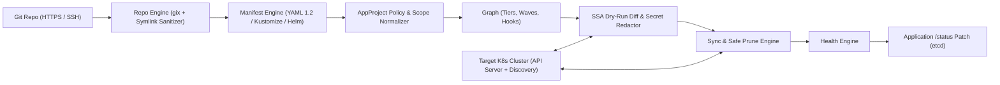

# FerrisCD

[](https://github.com/tuantran0910/ferris-cd/actions/workflows/ci.yml)
[](LICENSE)
[-orange.svg)](rust-toolchain.toml)
[](deploy/kind-config.yaml)

**FerrisCD** is a Kubernetes-native GitOps Continuous Delivery platform written in **Rust** (`Edition 2024`, `kube 5.1`, `k8s-openapi 0.29`), built with two equal goals:

1. **The Engineering Platform (`v0.1` -> `v1.0`):** A memory-safe, zero-Redis GitOps engine, Kubernetes controller, REST/OpenAPI server, CLI, and modern TypeScript Web UI.
2. **The Knowledge Base:** Architecture Decision Records (`docs/adr/`) and 16 hands-on phase lessons (`docs/lessons/`) paired with reproducible local `kind` Kubernetes experiments.

---

## Architecture Highlights

FerrisCD combines an **Argo CD-grade operator UX** (`Application` & `AppProject` CRDs, sync waves & lifecycle hooks, orthogonal Sync vs. Health status) with a **Flux-inspired Server-Side Apply (SSA) core**:

- **SSA-First (`force: false` default):** Uses `Patch::Apply` and `dryRun=All` diffing directly against `kube-apiserver`, eliminating legacy client-side 3-way merge and external Redis/database dependencies.
- **Version-Agnostic GKNN Inventory:** Keys `.status.inventory` on `Group + Kind + Namespace + Name` (with `version` stored only as a hint) and updates crash-safely via `next = (prev \ pruned_ok) ∪ applied_ok`.
- **Single-Binary Modular Monolith:** Clean crate boundaries (`ferriscd-crd`, `ferriscd-engine`, `ferriscd-controller`, `ferriscd-cli`, plus `ferriscd-server` in Phase 14) sharing in-process repo/cluster caches.
- **Defense-in-Depth Security:** Pure-Rust `gix` with per-repo locked commit cache, worktree-wide symlink sanitization before any renderer runs, `serde-saphyr` YAML 1.2 parser budgets, `Secret` redaction, and `ServiceAccount` impersonation.



---

## Workspace Layout

| Path | Description |
|---|---|
| `crates/ferriscd-crd` | Declarative `Application` & `AppProject` CRDs (`ferriscd.io/v1alpha1`), compact GKNN inventory, `OperationState` |
| `crates/ferriscd-engine` | Pure GitOps engine (`repo`, `manifest`, `inventory`, `diff`, `graph`, `sync`, `health`, `policy`) |
| `crates/ferriscd-controller` | `kube-rs` controller runtime, composite watch predicates, `DiscoveryCache`, finalizers, Lease HA |
| `crates/ferriscd-cli` | `ferriscd` CLI binary (`apply-file`, standalone `apply`, controller runner, API client) |
| `deploy/` | `kind` v1.35 cluster config, generated CRDs, manifests, and Helm chart |
| `examples/` | Reproducible Kubernetes manifest fixtures |
| `docs/` | [Master Plan](docs/MASTER_PLAN.md), [Roadmap](docs/ROADMAP.md), [ADRs](docs/adr/), and [Phase Lessons](docs/lessons/) |

---

## Quick Start (Local `kind` Cluster)

**Prerequisites:** Rust `1.99+`, Docker, `kind` (`v0.33+`), `kubectl` (`v1.35+`).

```bash
# 1. Verify formatting, clippy lints, and unit tests
make lint && make test

# 2. Spin up local Kubernetes v1.35.8 kind cluster (ferriscd-dev)
make kind-up

# 3. Verify context safety guard & apply a sample ConfigMap via SSA
kubectl config current-context | grep -q '^kind-'
cargo run -p ferriscd-cli -- apply-file examples/basic/configmap.yaml --namespace default
kubectl get cm demo-config -n default -o yaml --show-managed-fields
```

---

## Roadmap & Milestones

See [docs/ROADMAP.md](docs/ROADMAP.md) for all 82 atomic tasks across 16 phases:

| Milestone | Phases | Deliverable |
|---|---|---|
| **M0 — Walking Skeleton** | Phase 01 | 4-crate workspace, CI, `kind` v1.35 scripts, ADRs 0001–0003, live SSA `ferriscd apply-file`, Lesson 01 |
| **`v0.1` — Standalone Engine** | Phases 02–03 | `gix` repo cache & symlink sanitizer, YAML 1.2 + normalizer, `ferriscd apply` |
| **`v0.2` — K8s-Native Controller** | Phases 04–06 | `Application`/`AppProject` CRDs, `DiscoveryCache`, composite predicates, finalizers, GKNN pruning |
| **`v0.3` — Intelligent Diff & Health** | Phases 07–09 | SSA `dryRun=All` diffing, `ignoreDifferences`, `Secret` redaction, workload health lattice, self-heal |
| **`v0.4` — Orchestration & Ecosystem** | Phases 10–11 | Re-entrant sync waves & hooks, rollback, sandboxed Kustomize v5 & Helm v4 renderers |
| **`v1.0` — Enterprise Platform** | Phases 12–16 | Multi-tenancy & SA impersonation, multi-cluster & Lease HA, Axum REST/OpenAPI + webhooks, React 19 Web UI |

---

## Documentation & Knowledge Base

- [Project Master Plan](docs/MASTER_PLAN.md)
- [Master Roadmap & Track Index](docs/ROADMAP.md)
- [Adversarial Review & Trap Audit Log](docs/REVIEW_LOG.md)
- [Architecture Decision Records (`docs/adr/`)](docs/adr/)
- [Phase Lessons & `kind` Experiments (`docs/lessons/`)](docs/lessons/)

## Contributing & Security

- Please read [CONTRIBUTING.md](CONTRIBUTING.md) before opening a pull request.
- For security vulnerabilities, see [SECURITY.md](SECURITY.md).
- Licensed under the [Apache License, Version 2.0](LICENSE).
