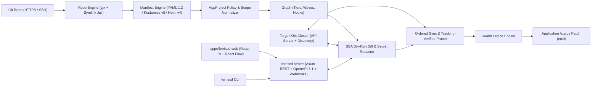

# FerrisCD

[](https://github.com/tuantran0910/ferris-cd/actions/workflows/ci.yml)
[](LICENSE)
[-orange.svg)](rust-toolchain.toml)
[](deploy/kind-config.yaml)

**FerrisCD `v1.0`** is a Kubernetes-native GitOps Continuous Delivery platform written in **Rust** (`Edition 2024`, `kube 5.1`, `k8s-openapi 0.29`) with a modern **TypeScript / React 19** Web Dashboard, built with two equal goals:

1. **The Engineering Platform (`v1.0`):** A memory-safe, zero-Redis GitOps engine, Kubernetes controller, in-process `axum` REST/OpenAPI 3.1 server, full `ferriscd` CLI, React 19 + React Flow Web Dashboard, hardened non-root container images, and production Helm/Kustomize packaging.
2. **The Knowledge Base:** Architecture Decision Records ([`docs/adr/`](docs/adr/)) and **16 hands-on phase lessons** ([`docs/lessons/`](docs/lessons/README.md)) paired with reproducible local `kind` Kubernetes experiments.

---

## Architecture Highlights

FerrisCD combines an **Argo CD-grade operator UX** (`Application` & `AppProject` CRDs, sync waves & lifecycle hooks, orthogonal Sync vs. Health status, interactive resource DAG) with a **Flux-inspired Server-Side Apply (SSA) core**:

- **SSA-First (`serverSideForce: false` default):** Uses `Patch::Apply` and `dryRun=All` diffing directly against `kube-apiserver`, eliminating legacy client-side 3-way merge and external Redis/database dependencies ([ADR-0001](docs/adr/0001-hybrid-ssa-architecture.md)).
- **Version-Agnostic GKNN Inventory:** Keys `.status.inventory` strictly on `Group + Kind + Namespace + Name` (never `version`), updates crash-safely via `next = (prev \ pruned_ok) ∪ applied_ok`, and verifies `ferriscd.io/tracking-id` immediately before pruning ([ADR-0003](docs/adr/0003-gknn-inventory-and-tracking-id.md)).
- **Single-Binary Modular Monolith + Typed Web UI:** Five cohesive Rust crates (`ferriscd-crd`, `ferriscd-engine`, `ferriscd-controller`, `ferriscd-server`, `ferriscd-cli`) share in-process repo, render, discovery, and cluster caches ([ADR-0002](docs/adr/0002-modular-monolith-workspace.md)). `ferriscd-server` exports an OpenAPI 3.1 contract ([`docs/api/openapi.json`](docs/api/openapi.json)) that generates strictly typed clients for `apps/ferriscd-web`.
- **Enterprise Security & Operations:** Pure-Rust `gix` with per-repo locked mirror/worktree cache, worktree-wide symlink jail, `serde-saphyr` YAML 1.2 parser budgets, sandboxed Kustomize v5 & Helm v4 renderers, `Secret` redaction, `AppProject` + `ServiceAccount` impersonation, `TokenReview` AuthN + default-deny `ferriscd-rbac-cm`, hardened GitHub/GitLab webhooks, `coordination.k8s.io/v1` Lease HA + sharding, and low-cardinality Prometheus/OTLP observability.



---

## Workspace Layout

| Path | Description |
|---|---|
| `crates/ferriscd-crd` | Declarative `Application` & `AppProject` CRDs (`ferriscd.io/v1alpha1`), compact GKNN inventory, `OperationState`, deterministic CRD generator |
| `crates/ferriscd-engine` | Pure GitOps engine (`repo`, `manifest`, `inventory`, `diff`, `graph`, `sync`, `health`, `policy`) |
| `crates/ferriscd-controller` | `kube-rs` controller runtime, composite predicates, `DiscoveryCache`, finalizers, impersonation, `ClusterManager`, Lease HA, sharding, Prometheus/OTLP/Events |
| `crates/ferriscd-server` | In-process `axum` REST API + `utoipa` OpenAPI 3.1 server, hardened GitHub/GitLab webhooks, `TokenReview` AuthN, project-scoped `ferriscd-rbac-cm` RBAC |
| `crates/ferriscd-cli` | Unified `ferriscd` binary (`server`, `controller`, `login`, `app`, `project`, `cluster`, `apply`, `apply-file`, `crd`) |
| `apps/ferriscd-web` | React 19 + TypeScript + Vite + Tailwind CSS v4 + TanStack Query v5 + React Flow Web Dashboard generated from `docs/api/openapi.json` |
| `deploy/` | Production Helm chart (`deploy/helm/ferriscd/`), Kustomize overlay (`deploy/manifests/`), generated CRDs (`deploy/crds/`), and `kind` v1.35 config |
| `examples/` | Reproducible plain YAML, Kustomize, Helm, CRD+CR, and sync-wave/hook fixtures |
| `docs/` | [Master Plan](docs/MASTER_PLAN.md), [Roadmap](docs/ROADMAP.md), [Operations Runbook](docs/operations/RUNBOOK.md), [Knowledge Base Index](docs/lessons/README.md), [ADRs](docs/adr/), and [v1.0 Benchmarks](docs/benchmarks/v1.0.md) |

---

## 10-Minute Quick Start (`kind` Cluster)

**Prerequisites:** Rust `1.100.0` (Edition 2024), Docker, `kind` (`v0.33+`), `kubectl` (`v1.35+`), `git`, and optionally `helm` (`v4.3+`) & Node.js `22+` (for the Web Dashboard).

### 1. Spin up a local `kind` cluster & install CRDs + `default` `AppProject`

```bash
# Start local Kubernetes v1.35.8 kind cluster (`ferriscd-dev`)
make kind-up

# Always verify context safety guard before applying anything
kubectl config current-context | grep -q '^kind-'

# Apply FerrisCD CRDs, control-plane namespace, default AppProject, and an admin RBAC ConfigMap
kubectl apply --server-side -f deploy/crds/
kubectl wait --for=condition=Established --timeout=60s \
  crd/applications.ferriscd.io crd/appprojects.ferriscd.io
kubectl apply -f deploy/manifests/namespace.yaml
kubectl apply -f deploy/manifests/default-project.yaml

# Create a ServiceAccount for local CLI/UI login and grant it admin in ferriscd-rbac-cm
kubectl -n ferriscd-system create serviceaccount ferriscd-admin \
  --dry-run=client -o yaml | kubectl apply -f -
kubectl apply -f - <<'EOF'
apiVersion: v1
kind: ConfigMap
metadata:
  name: ferriscd-rbac-cm
  namespace: ferriscd-system
data:
  policy.yaml: |
    rules:
      - subject:
          kind: user
          name: system:serviceaccount:ferriscd-system:ferriscd-admin
        project: "*"
        actions: [admin]
EOF
```

### 2. Run `ferriscd server` (Controller + REST API + Metrics)

```bash
# Build the unified binary once
cargo build --bin ferriscd

# Start controller + REST API (:8080) + Prometheus /metrics (:9090)
./target/debug/ferriscd server \
  --namespace ferriscd-system \
  --allow-local-repos \
  --api-addr 127.0.0.1:8080 \
  --metrics-addr 127.0.0.1:9090 \
  --auth-policy token-review &
SERVER_PID=$!

# Confirm API liveness (retries briefly while the listener binds)
curl -sf --retry 10 --retry-delay 1 --retry-connrefused http://127.0.0.1:8080/healthz && echo ""
```

### 3. Deploy an example `Application` & inspect via `ferriscd` CLI

```bash
# Seed a local Git repository from examples/basic
DEMO_REPO="$(mktemp -d)/demo-repo"
mkdir -p "${DEMO_REPO}/app"
cp examples/basic/configmap.yaml examples/basic/deployment.yaml examples/basic/service.yaml "${DEMO_REPO}/app/"
git -C "${DEMO_REPO}" init -b main
git -C "${DEMO_REPO}" config user.name "FerrisCD Demo"
git -C "${DEMO_REPO}" config user.email "demo@ferriscd.local"
git -C "${DEMO_REPO}" add . && git -C "${DEMO_REPO}" commit -m "initial demo app"

# Submit an Application CR pointing at the local Git repo
kubectl apply -f - <<EOF
apiVersion: ferriscd.io/v1alpha1
kind: Application
metadata:
  name: demo-app
  namespace: ferriscd-system
spec:
  project: default
  source:
    git:
      repoURL: "file://${DEMO_REPO}"
      targetRevision: main
      path: app
  destination:
    cluster: in-cluster
    namespace: ferriscd-demo
  syncPolicy:
    automated:
      prune: true
      selfHeal: true
    syncOptions:
      createNamespace: true
EOF

# Mint a short-lived Kubernetes ServiceAccount token and authenticate the CLI via TokenReview
kubectl -n ferriscd-system create token ferriscd-admin --duration=1h > /tmp/ferriscd-admin.token
chmod 0600 /tmp/ferriscd-admin.token
./target/debug/ferriscd login http://127.0.0.1:8080 --token-file /tmp/ferriscd-admin.token

# Inspect Sync/Health status, live Secret-redacted SSA dry-run diff, and deployment history
./target/debug/ferriscd app list
./target/debug/ferriscd app get demo-app -n ferriscd-system
./target/debug/ferriscd app diff demo-app -n ferriscd-system
./target/debug/ferriscd app history demo-app -n ferriscd-system
```

### 4. Launch the Modern Web Dashboard (optional)

```bash
cd apps/ferriscd-web
npm ci
npm run dev
# Open http://127.0.0.1:5173 and paste the token from /tmp/ferriscd-admin.token
```

*(When finished, stop the server with `kill -TERM "${SERVER_PID}"`, remove `/tmp/ferriscd-admin.token` and `${DEMO_REPO}`, or delete the cluster with `make kind-down`.)*

---

## Deploying In-Cluster (Helm & Kustomize)

For production or full in-cluster `kind` deployments using the hardened non-root images ([`Dockerfile`](Dockerfile) & [`apps/ferriscd-web/Dockerfile`](apps/ferriscd-web/Dockerfile)):

```bash
# Single-replica Helm install (with restricted PodSecurityStandard & default-deny NetworkPolicy)
helm install ferriscd deploy/helm/ferriscd -n ferriscd-system --create-namespace

# Production HA Helm install (2 replicas + Lease leader election + PDB + anti-affinity)
helm install ferriscd deploy/helm/ferriscd \
  -n ferriscd-system --create-namespace \
  -f deploy/helm/ferriscd/values-ha.yaml

# Or Kustomize overlay install
kubectl apply --server-side -f deploy/crds/
kubectl wait --for=condition=Established --timeout=60s \
  crd/applications.ferriscd.io crd/appprojects.ferriscd.io
kubectl apply -k deploy/manifests
```

See [Lesson 16](docs/lessons/16-packaging-hardening-and-production-gitops.md) for building/loading local Docker images into `kind`, and [docs/operations/RUNBOOK.md](docs/operations/RUNBOOK.md) for Day-2 upgrades, HA failover, RBAC, and incident triage.

---

## CLI Surface Overview (`ferriscd`)

| Command | Purpose |
|---|---|
| `ferriscd server` | Run controller + in-process REST API (`:8080`) + Prometheus metrics (`:9090`) + webhooks |
| `ferriscd server openapi [--check]` | Export or verify `docs/api/openapi.json` (source of truth for Web UI codegen) |
| `ferriscd controller` | Run the Kubernetes controller standalone (`--leader-election`, `--shard-id`/`--total-shards`) |
| `ferriscd login <url> --token-file <path>` | Verify and store a Kubernetes bearer token (`0600` in `~/.config/ferriscd/config.json`) |
| `ferriscd app {list\|get\|diff\|sync\|rollback\|history}` | Manage applications via REST API (`--output table\|json\|yaml`; `diff` exits `2` on drift) |
| `ferriscd project list` / `ferriscd cluster list` | Inspect authorized `AppProject`s and registered clusters |
| `ferriscd apply` / `ferriscd apply-file` | Standalone `v0.1` Git-to-SSA / single-file SSA applier |
| `ferriscd crd generate [--check]` | Deterministically generate or verify `deploy/crds/*.yaml` |

---

## Roadmap & Milestones

See [docs/ROADMAP.md](docs/ROADMAP.md) for the complete roadmap across Tracks A–E:

| Milestone | Phases | Deliverable |
|---|---|---|
| **M0 — Walking Skeleton** | Phase 01 | Cargo workspace, CI, `kind` v1.35 scripts, ADRs 0001–0003, `ferriscd apply-file`, Lesson 01 |
| **`v0.1` — Standalone Engine** | Phases 02–03 | `gix` repo cache & symlink jail, YAML 1.2 + normalizer, `ferriscd apply` |
| **`v0.2` — K8s-Native Controller** | Phases 04–06 | `Application`/`AppProject` CRDs, `DiscoveryCache`, composite predicates, finalizers, GKNN inventory |
| **`v0.3` — Intelligent Diff & Health** | Phases 07–10 | SSA `dryRun=All` diffing, `ignoreDifferences`, `Secret` redaction, workload health lattice, waves, hooks & rollback |
| **`v0.4` — Ecosystem Renderers** | Phase 11 | Sandboxed Kustomize v5 & Helm v4 renderers, SSRF/symlink hardening, collision-free `RenderCache` |
| **`v0.5` — Multi-Tenant & HA** | Phases 12–13 | `AppProject` enforcement, pooled `ServiceAccount` impersonation, remote clusters, native Lease HA & sharding |
| **`v1.0` — Enterprise Platform & Web UI** | Phases 14–16 | Axum REST/OpenAPI + webhooks, `TokenReview` + RBAC, full CLI, Prometheus/OTLP/chaos, React 19 + React Flow Web UI, hardened containers, Helm/Kustomize & release pipeline |
| **Post-`v1.0` (`v1.1`–`v2.0`)** | Phases 17–20 | Live RBAC reload, audit trail, sync windows, `DriftWatcher`, OCI sources, OIDC SSO, `ApplicationSet`, multi-source & policy gates |

---

## Documentation & Knowledge Base

- [Knowledge Base Curriculum Index (All 16 Lessons & ADRs)](docs/lessons/README.md)
- [Production Operations Runbook (`v1.0`)](docs/operations/RUNBOOK.md)
- [Project Master Plan](docs/MASTER_PLAN.md)
- [Master Roadmap & Track Index](docs/ROADMAP.md)
- [Scale & Memory Soak Benchmark (`v1.0`)](docs/benchmarks/v1.0.md)
- [Adversarial Review & Trap Audit Log](docs/REVIEW_LOG.md)
- [Deployment & RBAC Matrix Notes](deploy/README.md)

## Contributing & Security

- Please read [CONTRIBUTING.md](CONTRIBUTING.md) before opening a pull request.
- For our `v1.0` threat model and vulnerability disclosure process, see [SECURITY.md](SECURITY.md).
- Licensed under the [Apache License, Version 2.0](LICENSE).
