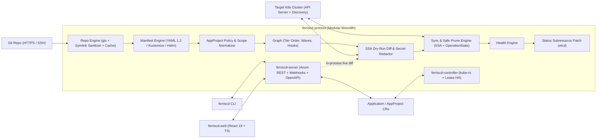

# FerrisCD — Project Master Plan

> **Version:** 2.0 (Post Adversarial Review Loop & Design Alignment)  
> **Project:** FerrisCD — A Kubernetes-Native GitOps Continuous Delivery Platform in Rust  
> **Status:** Ready for Phase 01 Execution  
> **Verified Local Environment:** `rustc 1.99.0`, `cargo 1.99.0`, `git 2.54.0`, `kind 0.33.0`, `kubectl v1.35.0`, `helm v4.3.2`, `kustomize v5.8.3`

---

## 1. Vision, Goals, and Non-Goals

### 1.1 Vision
Build **FerrisCD**, an educational yet production-oriented **GitOps Continuous Delivery platform in Rust** that continuously reconciles declarative desired state stored in Git with one or more Kubernetes clusters—without delegating core GitOps logic to Argo CD or Flux CD.

FerrisCD delivers **two equal outcomes**:
1. **The Engineering Platform:** A modular, memory-safe, thoroughly tested GitOps CD engine, Kubernetes controller, control-plane API, CLI, and modern Web UI.
2. **The Knowledge Base:** Numbered Architecture Decision Records (`docs/adr/`) and **16 focused phase lessons** (`docs/lessons/`) paired with reproducible `kind` Kubernetes experiments explaining *why* every design choice exists and how real GitOps platforms fail in production.

### 1.2 Core Goals
- Implement all four OpenGitOps principles: **Declarative**, **Versioned & Immutable**, **Pulled Automatically**, and **Continuously Reconciled**.
- Deliver an **Argo CD-grade operator & developer experience** (`Application` and `AppProject` CRDs, orthogonal Sync vs. Health status, sync waves & hooks, redacted diff previews, CLI, REST API, and modern Web UI).
- Power the core with a **Flux-inspired modern Kubernetes engine**: **Server-Side Apply (SSA) first**, `dryRun=All` diffing, API-backed `.status.inventory`, and **zero external database or Redis dependency**.
- Build security and multi-tenancy into the architecture from day one (control-plane namespace isolation through `v0.4`, optional Apps-in-any-namespace + mandatory `ServiceAccount` impersonation in Phase 12, worktree-wide symlink sanitization, Kustomize remote-base blocking, and Secret redaction).
- Ship **6 live-verified milestones** (`v0.1` -> `v1.0`) against real `kind` (Kubernetes v1.35) clusters.

### 1.3 Explicit Non-Goals
- **Not a 1:1 clone of Argo CD or Flux CD.** ApplicationSets, built-in Dex SSO, Jsonnet, and legacy client-side 3-way strategic-merge diffing are out of scope for `v1.0`.
- **Not rewriting foundational protocols.** We rely on maintained crates for HTTP/TLS, Kubernetes API transport (`kube`), Git protocol (`gix`), YAML 1.2 parsing (`serde-saphyr`), and sandboxed `helm`/`kustomize` rendering.
- **Not premature microservices.** FerrisCD runs as a **single-binary modular monolith** (controller + API server sharing in-process `RepoCache`, `ClusterManager`, and `DiffEngine`), while preserving clean Rust module/trait boundaries for future separation.
- **Not non-Kubernetes targets** (VMs, Nomad, bare-metal) in `v1.0`.

---

## 2. Functional & Non-Functional Requirements

### 2.1 Functional Requirements
| ID | Capability | Summary |
|----|-----------|---------|
| FR-01 | Git Source Management | Clone/fetch HTTPS & SSH repos (`gix`), resolve branches/tags/SHAs, shallow fetch, per-repo locked commit cache, `known_hosts` verification |
| FR-02 | Manifest Generation | Multi-doc YAML 1.2 parsing (`serde-saphyr`), `v1/List` flattening, offline + cluster-aware normalization, sandboxed Kustomize v5 & Helm v4 renderers |
| FR-03 | Declarative CRDs | `Application` & `AppProject` CRDs (`ferriscd.io/v1alpha1`) with OpenAPI schema validation, `/status` subresource, and printer columns |
| FR-04 | Continuous Reconciliation | Composite watch predicates (never swallowing deletions/finalizers/operations), periodic requeue, Git webhook wakeups, always-update-status on error |
| FR-05 | SSA Dry-Run Diff & Drift | `Patch::Apply` with `dryRun=All`, `managedFields`-aware conflict reporting, `ignoreDifferences` (JSON Pointer), Secret redaction, brownfield adoption guidance |
| FR-06 | Ordered Sync & Orchestration | Deterministic kind priority ordering, CRD-before-CR with mid-sync `Discovery` refresh, crash-safe re-entrant sync waves (`OperationState`), lifecycle hooks (`generateName` supported), immutable-field `Replace` opt-in |
| FR-07 | Safe Pruning & Self-Healing | Version-agnostic GKNN inventory + `ferriscd.io/tracking-id` ownership verification; never auto-prune CRDs/Namespaces by default; distinct `automated` vs `selfHeal` semantics |
| FR-08 | Health Assessment | Independent health lattice (`Degraded > Missing > Progressing > Suspended > Healthy > Unknown`) covering core workloads, edge cases (`paused`, `replicas: 0`, `OnDelete` STS), and generic CRD conditions |
| FR-09 | History & Rollback | Bounded metadata-only `status.history` (hard cap 20) and safe Git-revision rollback that avoids immediate `HEAD` re-overwrite |
| FR-10 | Security & Multi-Tenancy | `AppProject` allow-lists (checked on every rendered resource's actual namespace), `ServiceAccount` impersonation (with `Impersonate-Group` headers & pooled connectors), worktree symlink/SSRF defense |
| FR-11 | Multi-Cluster & HA | Secret-registered remote clusters with TLS validation, Lease-based active/standby leader election, opt-in deterministic sharding |
| FR-12 | API, CLI & Modern Web UI | OpenAPI-documented `axum` REST API, GitHub/GitLab webhooks, `ferriscd` CLI, Prometheus/OTel observability, and modern TypeScript Web Dashboard (`React 19 + TypeScript + Vite + Tailwind + TanStack Query + React Flow`) |

### 2.2 Non-Functional Requirements
- **Idempotency:** Reconciling an already-synced `Application` N times performs zero mutating Kubernetes writes (`applyOutOfSyncOnly: true`).
- **Crash Safety:** Killing the controller mid-sync or mid-wave leaves no corrupted external DB; `status.inventory` and `status.operationState` in `etcd` allow clean convergence on restart.
- **Bounded `etcd` Footprint:** Never store rendered YAML or diffs in `Application.status`; inventory uses compact GKNN entries and history is hard-capped at 20 metadata-only entries (<100 KB even at 500 resources).
- **Least Privilege & Secret Hygiene:** Never log, expose in diffs, or persist plaintext `Secret` data, Git credentials, or controller SA tokens; child renderer subprocesses run with cleared env and blocked SSRF.
- **Predictable Memory:** Scoped on-demand live fetching (no cluster-wide dynamic informer RAM explosion).

---

## 3. Architecture Decision Records (Summary)

| ADR | Decision | Key Rationale & Guardrails |
|-----|----------|----------------------------|
| **ADR-001** | **Hybrid Engine (Argo CD UX + Flux SSA Core)** | `Application`/`AppProject` UX + SSA `Patch::Apply`, `dryRun=All`, and `.status.inventory`. Avoids Redis and client-side 3-way merge. |
| **ADR-002** | **Single-Binary Modular Monolith (5 Crates)** | Start with 4 crates (`crd`, `engine`, `controller`, `cli`), add `server` in Phase 14 (embedded alongside controller in one process so `GET /diff` shares `RepoCache`, `ClusterManager`, and `DiffEngine` cleanly without duplicating infrastructure). |
| **ADR-003** | **Version-Agnostic GKNN Inventory + `tracking-id`** | Key `ResourceKey` and inventory equality strictly on **Group + Kind + Namespace + Name (GKNN)** (storing `version` as a non-key hint) so API/CRD version upgrades (`v1beta1` -> `v1`) never self-prune! Formula: `next_inventory = (prev_inventory \ pruned_ok) ∪ applied_ok`. Stamp `ferriscd.io/tracking-id` for ownership safety. |
| **ADR-004** | **Pure On-Demand Scoped Reconciliation (Model 1 for `v1.0`)** | Fetch `desired ∪ prev_inventory` on requeue, Git webhook, or spec/operation change—no background workload informers in `v1.0` (tiny RAM, native least-privilege impersonation, zero cache staleness). For the Web UI resource DAG, `GET .../resources` stitches child `ReplicaSet`/`Pod` nodes via on-demand `metadata.ownerReferences` traversal in `destination.namespace`. Trigger-only `PartialObjectMetadata` label watches (`ferriscd.io/app-hash`, 16-char SHA-256) are cleanly deferred to post-`v1.0` (`T16.8`). |
| **ADR-005** | **`gix` Behind `GitClient` Trait + Minimal Slim/Wolfi Image with `openssh-client`** | Pure-Rust Git protocol v2 + shallow fetch via `gix` (in `spawn_blocking`). Because `gix-transport` spawns `/usr/bin/ssh` for SSH URLs, the production image uses a minimal Wolfi/Debian-slim base bundling `openssh-client` + `ca-certificates` (non-root, read-only rootfs, `/tmp` `emptyDir` for `0600` ephemeral keys + explicit `known_hosts` verification). |
| **ADR-006** | **`serde-saphyr` YAML 1.2 + Budget Limits + `v1/List` Flattening** | Pure-Rust YAML 1.2 multi-doc parser with configured parser budgets (anti YAML-bomb), duplicate-key rejection, `None`/`Null` doc skipping, and recursive `v1/List` flattening. |
| **ADR-007** | **Phased Multi-Tenancy (`ferriscd-system` -> Apps-in-Any-Namespace)** | Through `v0.4`, `Application` and `AppProject` live strictly in `ferriscd-system` (`Api::namespaced`). Phase 12 adds opt-in Apps-in-any-namespace (`AppProject.spec.sourceNamespaces`) with mandatory `ServiceAccount` impersonation (`Impersonate-User` + `Impersonate-Group` via shared connector pool). |
| **ADR-008** | **Modern TypeScript Web UI (`apps/ferriscd-web`)** | Strictly decoupled SPA (`React 19`, `TypeScript`, `Vite`, `Tailwind CSS`, `TanStack Query`, `React Flow` for resource DAGs) backed by an OpenAPI 3.1 schema generated from `ferriscd-server` (`utoipa`) so frontend types stay 100% in sync with Rust types. |

---

## 4. Workspace & System Architecture

### 4.1 Workspace Layout
```text
ferris-cd/
├── Cargo.toml                  # Workspace manifest (Rust 2024, kube 5.1+, k8s-openapi 0.29, schemars 1)
├── rust-toolchain.toml
├── crates/
│   ├── ferriscd-crd/           # Application & AppProject CRDs, Status, Conditions, GKNN Inventory (NO k8s-openapi version feature!)
│   ├── ferriscd-engine/        # Pure GitOps engine & traits (NO k8s-openapi version feature!)
│   │   └── src/
│   │       ├── repo/           # GitClient trait, GixGitClient, per-repo lock cache, worktree symlink sanitizer, creds
│   │       ├── manifest/       # serde-saphyr YAML 1.2 parser, v1/List flattener, offline normalizer, Renderer trait (YAML/Kustomize/Helm), sandboxed exec
│   │       ├── inventory/      # GKNN ResourceKey, inventory set math, tracking-id stamper & verifier
│   │       ├── diff/           # SSA dry-run comparator, ignoreDifferences (RFC 6901), Secret redactor, sync decision gate
│   │       ├── graph/          # Priority tier ordering, sync wave partitioning, lifecycle hook partitioning
│   │       ├── sync/           # SyncPlan builder, wave/hook OperationState machine, SSA executor, Replace/prune safety
│   │       ├── health/         # Core workload & CRD health evaluators
│   │       └── policy/         # PermissivePolicy stub (v0.1-v0.4) -> AppProjectPolicy (Phase 12)
│   ├── ferriscd-controller/    # kube-rs Controller, composite watch predicates, DiscoveryCache, ClusterManager, Impersonation layer, Finalizers, Lease HA
│   ├── ferriscd-server/        # (Phase 14) Axum REST API, OpenAPI (utoipa), Git webhooks, AuthN/RBAC, metrics (runs in-process with controller)
│   └── ferriscd-cli/           # `ferriscd` binary: standalone `apply` (v0.1), `controller`/`server` runner, and full API CLI
├── apps/
│   └── ferriscd-web/           # (Phase 16) React 19 + TypeScript + Vite + Tailwind + TanStack Query + React Flow
├── deploy/
│   ├── crds/                   # Generated CRD YAML manifests
│   ├── manifests/              # Kustomize install overlays
│   └── helm/ferriscd/          # Production Helm chart
├── examples/                   # Sample GitOps repos (basic, crd-and-cr, waves-hooks, kustomize, helm)
├── tests/
│   ├── integration/            # Live `kind` (K8s v1.35) integration & chaos suites
│   └── fixtures/               # Git repos, YAML edge cases, K8s status snapshots, webhook payloads
└── docs/
    ├── MASTER_PLAN.md          # This document
    ├── ROADMAP.md              # Master Roadmap Index & Dependency DAG
    ├── roadmap/                # Track A–D detailed atomic task specifications
    ├── REVIEW_LOG.md           # Adversarial Review Loop & Trap Audit
    ├── adr/                    # Numbered Architecture Decision Records
    └── lessons/                # 16 Phase Lessons + hands-on `kind` experiments
```

### 4.2 High-Level Architecture


### 4.3 Trap-Free Reconciliation State Machine
1. **Watch Trigger (Composite Predicate — Never Swallows Deletions):**
   - Watch `Application` CRs (scoped to `ferriscd-system` by default; cluster-wide only when Apps-in-any-namespace is enabled).
   - Filter with a **custom composite predicate** hashing `(metadata.generation, metadata.deletion_timestamp, metadata.finalizers, annotations["ferriscd.io/refresh", "ferriscd.io/operation", "ferriscd.io/cascade-delete", "ferriscd.io/force-delete"])`. Pure `/status` patches produce identical hashes and never re-trigger reconciliation.
2. **Finalizer Gate (`kube_runtime::finalizer`) with Deadlock Escape:**
   - **Apply:** Ensure `ferriscd.io/finalizer` is present; proceed to Step 3.
   - **Cleanup (`deletionTimestamp` set):**
     - Default deletion is **non-cascading (orphan)** unless `ferriscd.io/cascade-delete: "true"` is set.
     - If cascading, delete every resource in `status.inventory` (verified by `tracking-id`) in reverse tier order; treat `404 NotFound`, `410 Gone`, and `NoMatchesForKind` as already-deleted.
     - **Deadlock escape hatch:** If the target Cluster Secret is deleted or `ferriscd.io/force-delete: "true"` is annotated, emit a `Warning` Event and strip the finalizer instead of wedging forever in `Terminating`.
3. **Wrapped Core Pipeline (Always-Update-Status Pattern):**
   - Execute inner pipeline returning `Result<ReconcileOutcome, ReconcileError>`:
     a. **Project & Client Acquisition:** Validate `Application` against `AppProject` (`PermissivePolicy` stub through Phase 11). Acquire pooled target `kube::Client` (with `Impersonate-User` + `Impersonate-Group` tower layer if `serviceAccountName` is set) and `DiscoveryCache`.
     b. **Repo Fetch & Worktree Sanitization:** Resolve `targetRevision` -> immutable `commit_sha`; fetch into commit-keyed cache under per-repo lock; **reject any symlink escaping repo root across the entire worktree before any renderer runs**.
     c. **Render & Two-Stage Normalization:**
        - Stage 1 (Offline): Parse multi-doc YAML 1.2 (with parser budget), flatten `v1/List`, skip null docs, strip `.status` & server metadata, convert `Secret.stringData` -> base64 `.data`, reject duplicate GKNN keys.
        - Stage 2 (Cluster-Aware): Consult `DiscoveryCache` (or in-bundle CRD `spec.scope`) to determine `Scope::Namespaced` vs `Scope::Cluster`; inject `destination.namespace` ONLY on namespaced objects lacking a namespace; reject namespaces on cluster-scoped objects; re-run `AppProject` checks against **every rendered resource's actual namespace and Group/Kind**!
     d. **Live State Discovery (Union, Version-Agnostic GKNN):**
        - Compute `to_fetch = desired_gknn ∪ prev_inventory_gknn`.
        - Fetch live objects (`404` -> `Missing`). If a desired CR's GVK is not yet in `Discovery` **and** a `CRD` in `desired` defines that GVK, mark it `DeferredPendingCrd` (do not fail!). If a resource's namespace is `404` **and** (`createNamespace: true` or that `Namespace` is in `desired`), mark it `DeferredPendingNamespace`.
        - Verify `ferriscd.io/tracking-id` on existing live objects (`OwnedBySelf`, `Unmanaged`, `OwnedByForeign`).
     e. **SSA Dry-Run Diff:**
        - Skip dry-run for `Missing`, `DeferredPendingCrd`, and `DeferredPendingNamespace` resources (automatically `OutOfSync`/`Missing`).
        - For existing live objects, run `Patch::Apply` (`dry_run: true`, `field_manager: "ferriscd"`, `force: serverSideForce`). Report `409 Conflict` cleanly as `FieldConflict` (listing conflicting manager + fields).
        - Compare canonicalized live vs dry-run objects (applying `ignoreDifferences` JSON Pointers on clones, never mutating desired payloads). Redact `Secret` values in all diff outputs/logs.
     f. **Sync Decision Gate:**
        - Compute `source_spec_hash = sha256(spec.source, spec.destination)`.
        - Manual operation (`ferriscd.io/operation`) -> **Sync**.
        - `syncPolicy.automated == None` -> **Skip Sync** (report drift only).
        - `automated.self_heal == false` -> **Sync ONLY if `(commit_sha, source_spec_hash) != (status.sync.last_synced_revision, status.sync.last_synced_spec_hash)`**.
        - `automated.self_heal == true` -> **Sync if revision/spec changed OR any resource is `OutOfSync`/`Missing` (or `Orphaned` when `automated.prune == true`)**.
     g. **Re-Entrant Sync & Wave Execution (`status.operationState`):**
        - Partition lifecycle hooks (`PreSync`, `Sync`, `PostSync`, `SyncFail`) and sync waves (`i32`, default `0`). Hooks support `generateName` (via `Api::create`) and never enter permanent `status.inventory`.
        - Execute one step/wave at a time, persisting `operationState` progress so waiting for a wave's resources to become `Healthy` **requeues** cleanly instead of blocking a controller worker thread.
        - Within each wave, apply in deterministic tier order (`Namespace` -> `CRD` -> `RBAC/SA` -> `ConfigMap/Secret` -> `Storage` -> `Workloads` -> `Services/Ingress` -> `Webhooks`).
        - If a `CRD` is applied, wait/requeue until `Established=True` and call `DiscoveryCache::invalidate_and_refresh()` before applying dependent CRs.
        - Immutable field `422` errors fail cleanly unless `ferriscd.io/sync-options: Replace=true` is annotated (which issues `Delete` and requeues until `404` before recreating).
        - Prune `Orphaned` resources (only if `prune: true`, `OwnedBySelf`, not annotated `ferriscd.io/prune=false`, and **never pruning `CRD` or `Namespace` unless explicitly opted in via `ferriscd.io/prune-crds=true` / `prune-namespaces=true`**) in reverse tier order.
        - **Crash-safe inventory update:** `next_inventory = (prev_inventory \ pruned_ok) ∪ applied_ok` (confirmed `404` counts as `pruned_ok`).
     h. **Health Assessment:** Evaluate all desired/live resources (checking `observedGeneration == generation` first, plus `paused`, `replicas: 0`, `OnDelete` STS, `Job.suspend`, `LoadBalancer` nuances) and aggregate `Application` health.
   - **Status Commit (Runs on BOTH `Ok` and `Err`):**
     - Patch `Application/status` via `Api::patch_status` with `observedGeneration`, `conditions`, `sync`, `health`, compact `inventory`, `operationState`, and bounded `history` (hard cap 20).
     - Requeue with fast cadence (e.g., 10s) when `Progressing` or an active wave/hook is running; normal `requeueAfterSeconds` (default 180s) when settled; exponential backoff on transient errors.

---

## 5. Declarative CRD Schema (`ferriscd.io/v1alpha1`)

```yaml
apiVersion: ferriscd.io/v1alpha1
kind: Application
metadata:
  name: payment-service
  namespace: ferriscd-system
  annotations:
    # Optional control annotations:
    # ferriscd.io/refresh: "<timestamp>"
    # ferriscd.io/operation: '{"sync":{"revision":"..."}}'
    # ferriscd.io/cascade-delete: "true"
    # ferriscd.io/force-delete: "true"
spec:
  project: payments                  # References AppProject in ferriscd-system (default: "default")
  serviceAccountName: payments-sa    # Resolved in destination.namespace (after AppProject authorizes cluster+ns)
  source:
    git:
      repoURL: https://github.com/example/payment-service.git
      targetRevision: main           # Branch, tag, or commit SHA
      path: deploy/production
    renderer:
      auto: {}                       # Or explicit: plainYaml | kustomize | helm (includeCRDs: false by default)
  destination:
    cluster: in-cluster              # "in-cluster" or Cluster Secret name
    namespace: payments
  syncPolicy:
    automated:                       # Omit for manual-only sync (prevents invalid automated=false+selfHeal=true)
      prune: false
      selfHeal: true
    syncOptions:
      createNamespace: false
      pruneLast: true
      pruneCRDs: false               # Safety rail: never auto-prune CRDs by default
      pruneNamespaces: false         # Safety rail: never auto-prune Namespaces by default
      serverSideForce: false         # Never blindly clobber HPA/controllers
      applyOutOfSyncOnly: true
      takeoverFieldManagers: []      # Optional brownfield adoption (e.g. ["kubectl-client-side-apply"])
    retry:
      limit: 5
      backoff:
        durationSeconds: 5
        factor: 2
        maxDurationSeconds: 180
  ignoreDifferences:
    - group: apps
      kind: Deployment
      jsonPointers:
        - /spec/replicas
  requeueAfterSeconds: 180
  revisionHistoryLimit: 10           # Validated 1..=20
```

### Compact `ApplicationStatus`
```yaml
status:
  observedGeneration: 4
  conditions:
    - type: Ready
      status: "True"
      reason: SyncSucceeded
      message: "Reconciled revision 8f3a1c2"
      lastTransitionTime: "2026-11-24T12:00:00Z"
  sync:
    status: Synced                   # Synced | OutOfSync | Unknown
    revision: 8f3a1c2e9d...
    lastSyncedRevision: 8f3a1c2e9d...
    lastSyncedSpecHash: "a1b2c3..."  # Ensures spec edits without new Git commits still trigger sync
    lastSyncedAt: "2026-11-24T12:00:00Z"
  health:
    status: Healthy                  # Healthy | Progressing | Degraded | Suspended | Missing | Unknown
    message: "All 4 resources are healthy"
  inventory:                         # Version-agnostic GKNN key + non-key version hint
    - key: "apps/Deployment/payments/payment-api"
      version: "v1"
    - key: "/Service/payments/payment-api"
      version: "v1"
  operationState:                    # Persists multi-wave / hook / rollback progress across requeues
    phase: Succeeded                 # Running | Succeeded | Failed | Error
    currentWave: 0
    startedAt: "2026-11-24T11:59:50Z"
    finishedAt: "2026-11-24T12:00:00Z"
  history:                           # Hard-capped at 20 metadata-only entries
    - id: 1
      revision: 8f3a1c2e9d...
      deployedAt: "2026-11-24T12:00:00Z"
```

---

## 6. Verified Technology Stack (2026)

| Layer | Choice | Notes & Verified Versions |
|-------|--------|---------------------------|
| Rust Toolchain | Rust 1.99+ (Edition 2024) | Verified locally (`rustc 1.99.0`, `cargo 1.99.0`) |
| Async Runtime | `tokio` 1.x | Standard async runtime + `spawn_blocking` for `gix` |
| Kubernetes Client & CRDs | `kube` `5.1.x` (`runtime`, `derive`, `client`, `rustls-tls`) + `k8s-openapi` `0.29.x` (`schemars`) + `schemars` `1` | Enable `k8s-openapi` feature `v1_35` **only** in binary/integration-test crates, **never** in library crates (`ferriscd-crd`, `ferriscd-engine`) |
| Leader Election | Native `coordination.k8s.io/v1` Lease elector on `kube 5.x` | ~150 lines, zero third-party lag behind `kube 5.x` |
| Git Backend | `gix` (gitoxide) behind `GitClient` trait | Pure-Rust HTTPS (`rustls`) + system `openssh-client` for SSH (`known_hosts` + `0600` ephemeral keys) |
| YAML 1.2 Parser | `serde-saphyr` | Pure-Rust YAML 1.2 with `from_multiple` + configured `Budget` (anti YAML-bomb) |
| JSON & Diff | `serde`, `serde_json`, `jsonptr` | RFC 6901 JSON Pointers for `ignoreDifferences` |
| Errors & Concurrency | `thiserror`, `anyhow`, `dashmap` | Typed transient vs terminal error classification |
| HTTP API & OpenAPI | `axum` + `tower` + `utoipa` | Generates OpenAPI 3.1 spec consumed by TypeScript frontend |
| CLI | `clap` 4.x | Subcommands, `table`/`json`/`yaml` outputs |
| Observability | `tracing`, `tracing-subscriber`, `prometheus-client`, `opentelemetry` | Low-cardinality metrics, OTLP traces, K8s Events |
| Web Frontend | **React 19 + TypeScript + Vite + Tailwind CSS + TanStack Query + React Flow** | Strictly decoupled SPA using generated OpenAPI TS client (`openapi-typescript`) |
| External Renderers | `helm` (`v4.3.2`), `kustomize` (`v5.8.3`) | Verified locally; sandboxed subprocess execution with timeouts & SSRF guards |
| Container Base | Minimal Wolfi / Debian-slim (`non-root`, `readOnlyRootFilesystem: true`) | Bundles `ferriscd`, `helm`, `kustomize`, `openssh-client`, `ca-certificates` |
| Local K8s Testing | `kind` (`0.33.0`) + `kubectl` (`v1.35.0`) | Verified locally for automated live integration & chaos suites |

---

## 7. Engineering Standards & Testing Pyramid

### 7.1 Quality Gates
- **CI (from Phase 01):** `cargo fmt --check`, `cargo clippy --all-targets -- -D warnings`, `cargo test --workspace`.
- **Safety Lints:** Deny `unwrap_used` / `expect_used` in library and controller runtime crates (allowed in tests).
- **Error Classification:** Every engine error implements `is_retryable() -> bool` so transient errors back off while terminal errors (bad YAML, policy violation) immediately report status without thrashing.
- **Knowledge Base Discipline:** Every completed phase ships 1 concise lesson (`docs/lessons/NN-<topic>.md`) with a runnable `kind` experiment, plus ADRs for non-obvious design decisions.

### 7.2 Four-Layer Testing Pyramid
1. **Unit Tests:** YAML 1.2 & YAML-bomb budgets, `v1/List` flattening, `Secret.stringData` conversion, GKNN inventory math, JSON diffing & Secret redaction, tier/wave/hook graphs, workload health snapshots, `AppProject` policy rules.
2. **Mocked Engine Contract Tests:** Full reconcile state machine against `FakeGitClient` + fake K8s client covering partial apply failure, partial prune failure, `selfHeal` truth table, wave requeue resumption, and rollback.
3. **Live `kind` Integration Tests (`tests/integration/`):** Real Kubernetes v1.35 SSA `managedFields`, HPA conflict, CRD+CR single-sync, brownfield adoption, finalizer cascade/escape-hatch, impersonation `403`, remote cluster, Lease failover.
4. **Scale & Chaos Suite (Phase 15):** 50 Applications / 500 resources latency + RSS soak benchmark, `SIGKILL` mid-sync, Git outage recovery, API server 429/500 resilience.

---

## 8. Companion Documents
- **Detailed Roadmap & Atomic Tasks:** [ROADMAP.md](file:///Users/tranngoctuan0910/Workspaces/PersonalRepo/ferris-cd/docs/ROADMAP.md)
  - [Track A: Walking Skeleton & Core Controller (Phases 01–06)](file:///Users/tranngoctuan0910/Workspaces/PersonalRepo/ferris-cd/docs/roadmap/track-a-core.md)
  - [Track B: Intelligent GitOps Engine (Phases 07–10)](file:///Users/tranngoctuan0910/Workspaces/PersonalRepo/ferris-cd/docs/roadmap/track-b-engine.md)
  - [Track C: Ecosystem Renderers, Security & Multi-Cluster (Phases 11–13)](file:///Users/tranngoctuan0910/Workspaces/PersonalRepo/ferris-cd/docs/roadmap/track-c-enterprise.md)
  - [Track D: API, Observability, Modern Web UI & v1.0 Release (Phases 14–16)](file:///Users/tranngoctuan0910/Workspaces/PersonalRepo/ferris-cd/docs/roadmap/track-d-platform.md)
- **Review Loop & Trap Audit:** [REVIEW_LOG.md](file:///Users/tranngoctuan0910/Workspaces/PersonalRepo/ferris-cd/docs/REVIEW_LOG.md)
