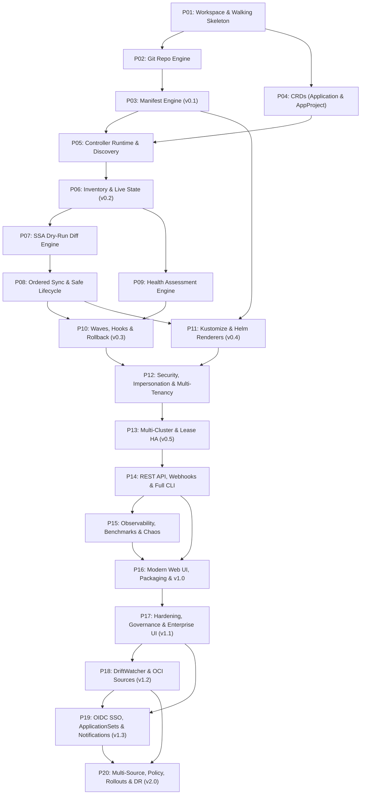

# FerrisCD — Master Roadmap & Task Index

> **Version:** 3.0 (Post-`v1.0` Enterprise Evolution Extension)  
> **Scope:** 20 Phases · 101 Atomic Tasks · 10 Milestones (`v0.1` -> `v2.0`, plus `M0`) · 20 Phase Lessons  
> **Task Sizing Rule:** Every task is scoped to **2–6 hours** of focused engineering work with explicit **Why / Problem Statement**, **Detailed Requirements**, **Outputs**, **Verification**, and **Trap Guard** (plus Priority, Workstream, Complexity & Risks in Track E).

---

## 1. Milestones & Definition of Done

| Milestone | Phases | Implementation Status | Cumulative Estimate (Part-Time) | Capability | Live `kind` Definition of Done |
|-----------|--------|-----------------------|---------------------------------|------------|--------------------------------|
| **M0 — Walking Skeleton** | Phase 01 | Verified | Week 1 | 4-crate Cargo workspace, CI, single-file SSA apply CLI | `ferriscd apply-file examples/basic/configmap.yaml` converges idempotently on `kind` |
| **v0.1 — Standalone GitOps Engine** | Phases 01–03 | Verified (Live `kind`) | Weeks 2–4 | `gix` Git engine, YAML 1.2 + `v1/List` + normalizer + symlink jail, `ferriscd apply` | `ferriscd apply --repo <local-git> --path examples/basic` deploys multi-file app idempotently |
| **v0.2 — K8s-Native Controller** | Phases 04–06 | Verified (Live `kind`) | Weeks 5–8 | `Application`/`AppProject` CRDs, `kube-rs` controller, composite predicate, finalizers, GKNN inventory, `tracking-id`, cluster-aware normalizer | Applying `Application` CR reconciles workloads automatically; status shows revision, conditions, GKNN inventory; updating Git auto-reconciles |
| **v0.3 — Intelligent GitOps Engine** | Phases 07–10 | Verified (Live `kind`) | Months 3–4 | SSA dry-run diff, Secret redaction, brownfield conflict reporting, CRD+CR single-sync, safe pruning, workload health engine, re-entrant sync waves & hooks, safe rollback | Automated `kind` E2E suite proves drift self-heal, safe orphan prune, foreign non-prune, CRD+CR single-sync, wave/hook gating, health transitions, and rollback |
| **v0.4 — Ecosystem Renderers** | Phase 11 | Verified (Live `kind`) | Month 5 | Sandboxed Kustomize v5 & Helm v4 renderers, SSRF/symlink hardening, full-key render cache | Deploy real Kustomize & Helm apps via `Application` CR; symlink, remote-base SSRF, and timeout security tests pass |
| **v0.5 — Multi-Tenant & HA Control Plane** | Phases 12–13 | Verified (Live `kind`) | Months 6–7 | `AppProject` enforcement, optional Apps-in-any-namespace, `ServiceAccount` impersonation (`Impersonate-Group` + pooled connectors), remote clusters, native Lease HA & sharding | Unauthorized namespace deploy rejected; impersonated SA gets `403` outside tenant ns; remote cluster deploy + 2-replica leader failover pass |
| **v1.0 — Production Platform & Modern Web UI** | Phases 14–16 | Verified (`26/26` Live `kind` + 30m Soak) | Months 8–10 | In-process `axum` REST API + OpenAPI, GitHub/GitLab webhooks, AuthN/RBAC, full CLI, Prometheus/OTel, chaos & scale benchmarks, React 19 + TS Web UI, hardened slim/Wolfi container + Helm chart | 50-app / 500-resource benchmark meets targets; chaos tests pass; Web UI displays live DAG + redacted diffs + triggers sync; clean `helm install` on fresh `kind` |
| **v1.1 — Production Hardening, Live Governance & Enterprise UI** | Phase 17 | Planned | Month 11 | Controller-backed `/readyz`, live-reloading YAML-budgeted RBAC, project-scoped clusters, compliance audit trail, Projects/Clusters/Events Web UI + WCAG 2.2 AA + SSE, `AppProject` sync windows, `cargo-deny`/SBOM/SLSA/Cosign supply chain | Live `ferriscd-rbac-cm` edits apply in <=2s without restart; `/readyz` gates on `InitDone`; deny sync window blocks auto-sync while emitting JSON audit events; signed SBOM/SLSA release verified |
| **v1.2 — Near-Real-Time Drift Detection & OCI Sources** | Phase 18 | Planned | Month 12 | `ClusterManager` lifecycle broadcast, hashed ownership labels (`ferriscd.io/app-hash`), opt-in `PartialObjectMetadata` `DriftWatcher` + `SelfEchoCache`, wire-compatible `spec.source.oci` CRD + tar-safe extraction + render cache | Out-of-band `kubectl edit configmap` self-heals in <10s with `requeueAfterSeconds: 600` and zero echo loops; Helm & Kustomize OCI artifacts deploy from local `registry:2` on `kind` with digest pinning |
| **v1.3 — Enterprise SSO/OIDC, ApplicationSets & Notifications** | Phase 19 | Planned | Months 13–14 | `OidcTokenAuthenticator` + `CompositeTokenAuthenticator`, Web PKCE (`S256` / optional BFF) & `ferriscd login --oidc` (`--sso` alias), `ApplicationSet` CRD (`List`/`Git`/`Cluster`/`Matrix` with safe deletion default), SSRF-hardened Slack/Teams/PagerDuty/Webhook notifications | Dex OIDC login works end-to-end in Web UI & CLI with group RBAC; `ApplicationSet` `Matrix` generates 6 apps across clusters without tenancy bypass; signed webhook notifications fire on sync/degrade |
| **v2.0 — Progressive Delivery, Policy-as-Code, Multi-Source & DR** | Phase 20 | Planned | Months 15–16 | Multi-source `Application` (`spec.sources[]`), pre-sync CEL & optional OPA/Rego policy gate, Gateway API/Rollouts/Flagger health + re-entrant metric-gated rollouts, secret-safe `ferriscd backup export/restore`, zero-downtime `v1.0 -> v2.0` upgrade, 250-app sharded scale + Fleet Overview UI | Split OCI chart + Git values app converges; CEL gate blocks non-compliant manifest pre-apply; `v1.0 -> v2.0` Helm upgrade passes with 0 workload restarts; 250-app / 2,500-resource 3-shard soak passes |

> **Scope Freeze Note:** `v1.0` (`Phases 01–16`) scope is strictly frozen to protect `v1.0` completion velocity. All `v1.1`–`v2.0` items in Track E are post-`v1.0` and plug into existing traits and additive `v1alpha1` schemas without conversion webhooks.

---

## 2. Phase Dependency Graph

---

## 3. Track Directory & Phase Index

Each track file below contains **full specifications for every atomic task** (`Why`, `Detailed Requirements`, `Outputs`, `Verification`, and `Trap Guard`) plus each phase's **Knowledge Base Lesson & Hands-On `kind` Experiment**.

### [Track A: Walking Skeleton & Core Controller (Phases 01–06)](roadmap/track-a-core.md)
- **Phase 01** (`T01.1`–`T01.5`): Workspace Scaffold, CI, ADRs & Walking Skeleton *(5 tasks)*
- **Phase 02** (`T02.1`–`T02.7`): Git Repository Engine (`gix`, locking cache, SSH/`known_hosts`, worktree symlink sanitizer, persistent per-URL mirror) *(7 tasks)*
- **Phase 03** (`T03.1`–`T03.6`): Manifest Engine (GKNN keys, `serde-saphyr` + budgets, `v1/List`, offline normalizer, minimal tier sort, `v0.1` CLI) *(6 tasks)*
- **Phase 04** (`T04.1`–`T04.4`): Declarative CRDs (`Application`, compact status/inventory/operationState, `AppProject`, CRD generator) *(4 tasks)*
- **Phase 05** (`T05.1`–`T05.5`): Controller Runtime (`DiscoveryCache`, composite watch predicate, finalizers + escape hatch, cluster-aware scope normalizer, graceful shutdown) *(5 tasks)*
- **Phase 06** (`T06.1`–`T06.4`): Inventory & Live State Engine (`tracking-id`, GKNN crash-safe inventory math, union live fetcher, `v0.2` controller integration) *(4 tasks)*

### [Track B: Intelligent GitOps Engine (Phases 07–10)](roadmap/track-b-engine.md)
- **Phase 07** (`T07.1`–`T07.5`): SSA Dry-Run Diff Engine (deferred CRD/NS handling, SSA dry-run + conflict reporting, canonical diff + `ignoreDifferences`, Secret redactor, sync decision gate with `source_spec_hash`) *(5 tasks)*
- **Phase 08** (`T08.1`–`T08.5`): Sync Engine, Dependency Ordering & Safe Lifecycle (full tier sort, `SyncPlan` + CRD/NS prune rails, CRD `Established` wait + discovery refresh, immutable-field `Replace` + brownfield takeover, reverse-order safe pruning) *(5 tasks)*
- **Phase 09** (`T09.1`–`T09.5`): Health Assessment Engine (health lattice, workloads evaluator + edge cases, Pods/Jobs/Network/Storage evaluators, CRD conditions heuristic, controller fast-requeue integration) *(5 tasks)*
- **Phase 10** (`T10.1`–`T10.6`): Orchestration: Re-Entrant Waves, Hooks & Rollback (`OperationState` machine, wave gating, lifecycle hooks + `generateName`, hook cleanup policies, bounded history & safe rollback, `v0.3` E2E suite) *(6 tasks)*

### [Track C: Ecosystem Renderers, Security & Multi-Cluster (Phases 11–13)](roadmap/track-c-enterprise.md)
- **Phase 11** (`T11.1`–`T11.5`): Manifest Renderers: Kustomize v5 & Helm v4 (`ManifestRenderer` trait, hardened subprocess runner, Kustomize + remote-base SSRF block, Helm with opt-in CRDs + `--kube-version`, collision-free render cache) *(5 tasks)*
- **Phase 12** (`T12.1`–`T12.4`): Security, Impersonation & Multi-Tenancy (`AppProject` enforcement on every resource's actual namespace, Apps-in-any-namespace opt-in, pooled `ServiceAccount` impersonation with `Impersonate-Group`, Secret-backed repo credentials) *(4 tasks)*
- **Phase 13** (`T13.1`–`T13.4`): Multi-Cluster & High Availability (`ClusterManager` + TLS validation, native `Lease` leader election on `kube 5.x`, deterministic opt-in sharding, `v0.5` E2E suite) *(4 tasks)*

### [Track D: API, Observability, Modern Web UI & v1.0 Release (Phases 14–16)](roadmap/track-d-platform.md)
- **Phase 14** (`T14.1`–`T14.6`): Control Plane API, Webhooks & Full CLI (in-process `axum` REST + `utoipa` OpenAPI + live diff, GitHub HMAC + `X-GitHub-Delivery` dedup & GitLab token webhooks with body cap & fan-out debounce, AuthN (`TokenReview`), project RBAC middleware, full `ferriscd` CLI) *(6 tasks)*
- **Phase 15** (`T15.1`–`T15.4`): Observability, Benchmarks & Chaos Testing (low-cardinality Prometheus metrics, OTLP traces & rate-limited K8s Events, 50-app/500-resource soak benchmark, chaos suite) *(4 tasks)*
- **Phase 16** (`T16.1`–`T16.8`): Modern Web UI, Packaging & `v1.0` Release (React 19 + TS + Vite + Tailwind + generated OpenAPI client scaffold, Apps overview & status badges, interactive React Flow resource DAG, redacted diff viewer + sync/rollback actions, hardened Wolfi/slim container image with `openssh-client`, production Helm chart + NetworkPolicy, Knowledge Base & `v1.0` release verification) *(8 tasks)*

### [Track E: Enterprise Evolution & Production Maturity (Phases 17–20)](roadmap/track-e-enterprise-evolution.md)
- **Phase 17** (`T17.1`–`T17.5`) — *`v1.1`*: Production Hardening, Live Governance & Enterprise Web UI (controller-backed `/readyz` + live-reloading YAML-budgeted `ferriscd-rbac-cm` + project-scoped `/clusters`, immutable JSON compliance audit trail, `ProjectsPage`/`ClustersPage`/Events timeline + WCAG 2.2 AA command palette + optional SSE, `AppProject.spec.syncWindows`, `cargo-deny`/`cargo-audit`/CycloneDX SBOM/SLSA/Cosign supply chain) *(5 tasks)*
- **Phase 18** (`T18.1`–`T18.4`) — *`v1.2`*: Near-Real-Time Drift Detection & OCI Artifact Sources (`ClusterManager` lifecycle broadcast + 16-hex `ferriscd.io/app-hash` labels, opt-in `PartialObjectMetadata` `DriftWatcher` + `SelfEchoCache` + `403` fallback, additive `spec.source.oci` CRD with CEL mutual exclusion + tar-safe extraction, render-cache/`AppProject` integration & live OCI `kind` E2E) *(4 tasks)*
- **Phase 19** (`T19.1`–`T19.4`) — *`v1.3`*: Enterprise SSO/OIDC, ApplicationSets & Notifications (`OidcTokenAuthenticator` + `CompositeTokenAuthenticator` with strict `alg` allowlist & per-entry `exp` TTL, Web PKCE `S256`/optional BFF & `ferriscd login --oidc` (`--sso` alias), `ApplicationSet` CRD with `List`/`Git`/`Cluster`/`Matrix` generators & safe deletion default, annotation-driven SSRF-hardened Slack/Teams/PagerDuty/Webhook notifications) *(4 tasks)*
- **Phase 20** (`T20.1`–`T20.5`) — *`v2.0`*: Progressive Delivery, Policy-as-Code, Multi-Source & Disaster Recovery (multi-source `spec.sources[]` split chart + values repos, pre-sync CEL & optional OPA/Rego policy gate, Gateway API/Rollouts/Flagger health evaluators & re-entrant metric-gated rollouts, secret-safe `ferriscd backup export/restore` & zero-downtime `v1.0 -> v2.0` upgrade soak, 250-app / 2,500-resource 3-shard benchmark + Fleet Overview dashboard) *(5 tasks)*

---

## 4. Enterprise Workstream Prioritization Matrix (Post-`v1.0`, Phases 17–20)

Every post-`v1.0` task in [Track E](roadmap/track-e-enterprise-evolution.md) maps explicitly to FerrisCD's **8 enterprise workstreams** and **4 priority tiers**:

| Enterprise Workstream | `v1.1` (Phase 17) | `v1.2` (Phase 18) | `v1.3` (Phase 19) | `v2.0` (Phase 20) |
|---|---|---|---|---|
| **1. Core Product Capabilities** | `T17.4` Sync Windows *(Essential)* | `T18.2` `DriftWatcher` *(Strategic)* · `T18.3` OCI Source *(Strategic)* · `T18.4` OCI Pipeline *(Essential)* | `T19.3` `ApplicationSet` *(Strategic)* | `T20.1` Multi-Source *(Strategic)* · `T20.3` Metric-Gated Rollouts *(Optional)* |
| **2. UI/UX & Design System** | `T17.3` Projects, Clusters, Events, WCAG 2.2 AA & SSE *(Essential)* | — | `T19.2` Web PKCE SSO Flow *(Essential)* | `T20.1` Multi-Source Badges *(Strategic)* · `T20.5` Fleet Overview *(Essential)* |
| **3. Architecture & Engineering Excellence** | `T17.1` Watch `/readyz` & Hot-Reload Guarded RBAC *(Blocker)* · `T17.5` Supply Chain *(Blocker)* | `T18.1` `ClusterManager` Broadcast & Hashed Labels *(Essential)* | — | `T20.4` CRD Backward-Compat Gate *(Essential)* |
| **4. Security & Governance** | `T17.1` Guarded RBAC & Scoped Clusters *(Blocker)* · `T17.2` Audit Trail *(Blocker)* · `T17.5` SBOM/SLSA/Cosign *(Blocker)* | `T18.3` Tar-Safe OCI Extraction *(Strategic)* | `T19.1` OIDC Authenticator *(Strategic)* | `T20.2` Pre-Sync CEL/Rego Policy Gate *(Strategic)* |
| **5. Reliability & Performance** | `T17.1` Readiness Gating *(Blocker)* | `T18.1` Cluster Lifecycle *(Essential)* · `T18.2` Metadata-Only `DriftWatcher` + `SelfEchoCache` *(Strategic)* | — | `T20.4` DR & Zero-Downtime Upgrades *(Essential)* · `T20.5` 250-App 3-Shard Soak *(Essential)* |
| **6. Enterprise Capabilities** | `T17.2` Compliance Audit *(Blocker)* · `T17.4` Sync Windows *(Essential)* | — | `T19.1` Corporate SSO *(Strategic)* · `T19.3` Fleet `ApplicationSet`s *(Strategic)* | `T20.5` Fleet-Wide Health & Federation Readiness *(Essential)* |
| **7. Integrations & Extensibility** | — | `T18.3` OCI Registries *(Strategic)* | `T19.4` Slack/Teams/PagerDuty/Webhook Notifications *(Strategic)* | `T20.2` OPA/Rego Gate *(Strategic)* · `T20.3` Gateway API / Rollouts / Flagger *(Optional)* |
| **8. Developer & Operator Experience** | `T17.3` Command Palette & Events UI *(Essential)* | `T18.4` OCI CLI/UI & Lesson 18 *(Essential)* | `T19.2` `ferriscd login --oidc` (`--sso` alias) *(Essential)* · `T19.4` Alerting & Lesson 19 *(Strategic)* | `T20.4` `ferriscd backup export/restore` & Runbook *(Essential)* |

**Priority Summary across Track E (18 Tasks):**
- **Production Blocker (3):** `T17.1`, `T17.2`, `T17.5`
- **Essential Improvement (7):** `T17.3`, `T17.4`, `T18.1`, `T18.4`, `T19.2`, `T20.4`, `T20.5`
- **Strategic Capability (7):** `T18.2`, `T18.3`, `T19.1`, `T19.3`, `T19.4`, `T20.1`, `T20.2`
- **Optional Enhancement (1):** `T20.3`
