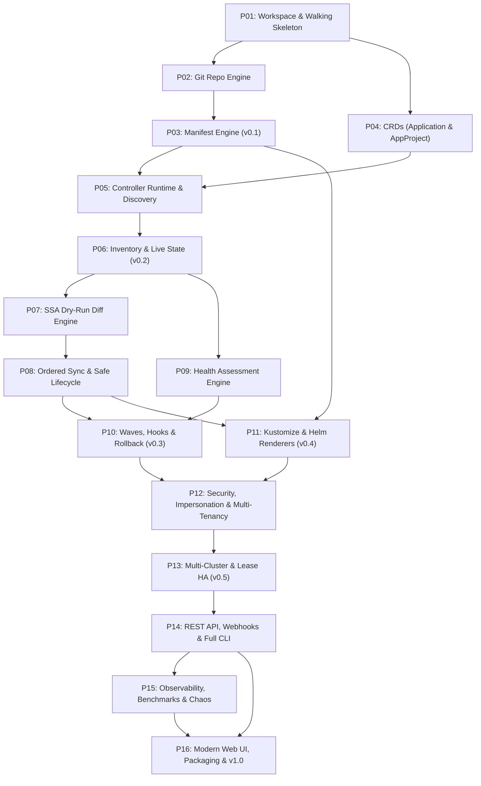

# FerrisCD — Master Roadmap & Task Index

> **Version:** 2.0 (Post Adversarial Review Loop & Design Alignment)  
> **Scope:** 16 Phases · 82 Atomic Tasks · 6 Milestones (`v0.1` -> `v1.0`) · 16 Phase Lessons  
> **Task Sizing Rule:** Every task is scoped to **2–6 hours** of focused engineering work with explicit **Why**, **Detailed Requirements**, **Outputs**, **Verification**, and **Trap Guard**.

---

## 1. Milestones & Definition of Done

| Milestone | Phases | Cumulative Estimate (Part-Time) | Capability | Live `kind` Definition of Done |
|-----------|--------|---------------------------------|------------|--------------------------------|
| **M0 — Walking Skeleton** | Phase 01 | Week 1 | 4-crate Cargo workspace, CI, single-file SSA apply CLI | `ferriscd apply-file examples/basic/configmap.yaml` converges idempotently on `kind` |
| **v0.1 — Standalone GitOps Engine** | Phases 01–03 | Weeks 2–4 | `gix` Git engine, YAML 1.2 + `v1/List` + normalizer + symlink jail, `ferriscd apply` | `ferriscd apply --repo <local-git> --path examples/basic` deploys multi-file app idempotently |
| **v0.2 — K8s-Native Controller** | Phases 04–06 | Weeks 5–8 | `Application`/`AppProject` CRDs, `kube-rs` controller, composite predicate, finalizers, GKNN inventory, `tracking-id`, cluster-aware normalizer | Applying `Application` CR reconciles workloads automatically; status shows revision, conditions, GKNN inventory; updating Git auto-reconciles |
| **v0.3 — Intelligent GitOps Engine** | Phases 07–10 | Months 3–4 | SSA dry-run diff, Secret redaction, brownfield conflict reporting, CRD+CR single-sync, safe pruning, workload health engine, re-entrant sync waves & hooks, safe rollback | Automated `kind` E2E suite proves drift self-heal, safe orphan prune, foreign non-prune, CRD+CR single-sync, wave/hook gating, health transitions, and rollback |
| **v0.4 — Ecosystem Renderers** | Phase 11 | Month 5 | Sandboxed Kustomize v5 & Helm v4 renderers, SSRF/symlink hardening, full-key render cache | Deploy real Kustomize & Helm apps via `Application` CR; symlink, remote-base SSRF, and timeout security tests pass |
| **v0.5 — Multi-Tenant & HA Control Plane** | Phases 12–13 | Months 6–7 | `AppProject` enforcement, optional Apps-in-any-namespace, `ServiceAccount` impersonation (`Impersonate-Group` + pooled connectors), remote clusters, native Lease HA & sharding | Unauthorized namespace deploy rejected; impersonated SA gets `403` outside tenant ns; remote cluster deploy + 2-replica leader failover pass |
| **v1.0 — Production Platform & Modern Web UI** | Phases 14–16 | Months 8–10 | In-process `axum` REST API + OpenAPI, GitHub/GitLab webhooks, AuthN/RBAC, full CLI, Prometheus/OTel, chaos & scale benchmarks, React 19 + TS Web UI, hardened slim/Wolfi container + Helm chart | 50-app / 500-resource benchmark meets targets; chaos tests pass; Web UI displays live DAG + redacted diffs + triggers sync; clean `helm install` on fresh `kind` |

---

## 2. Phase Dependency Graph

---

## 3. Track Directory & Phase Index

Each track file below contains **full specifications for every atomic task** (`Why`, `Detailed Requirements`, `Outputs`, `Verification`, and `Trap Guard`) plus each phase's **Knowledge Base Lesson & Hands-On `kind` Experiment**.

### [Track A: Walking Skeleton & Core Controller (Phases 01–06)](file:///Users/tranngoctuan0910/Workspaces/PersonalRepo/ferris-cd/docs/roadmap/track-a-core.md)
- **Phase 01** (`T01.1`–`T01.5`): Workspace Scaffold, CI, ADRs & Walking Skeleton *(5 tasks)*
- **Phase 02** (`T02.1`–`T02.6`): Git Repository Engine (`gix`, locking cache, SSH/`known_hosts`, worktree symlink sanitizer) *(6 tasks)*
- **Phase 03** (`T03.1`–`T03.6`): Manifest Engine (GKNN keys, `serde-saphyr` + budgets, `v1/List`, offline normalizer, minimal tier sort, `v0.1` CLI) *(6 tasks)*
- **Phase 04** (`T04.1`–`T04.4`): Declarative CRDs (`Application`, compact status/inventory/operationState, `AppProject`, CRD generator) *(4 tasks)*
- **Phase 05** (`T05.1`–`T05.5`): Controller Runtime (`DiscoveryCache`, composite watch predicate, finalizers + escape hatch, cluster-aware scope normalizer, graceful shutdown) *(5 tasks)*
- **Phase 06** (`T06.1`–`T06.4`): Inventory & Live State Engine (`tracking-id`, GKNN crash-safe inventory math, union live fetcher, `v0.2` controller integration) *(4 tasks)*

### [Track B: Intelligent GitOps Engine (Phases 07–10)](file:///Users/tranngoctuan0910/Workspaces/PersonalRepo/ferris-cd/docs/roadmap/track-b-engine.md)
- **Phase 07** (`T07.1`–`T07.5`): SSA Dry-Run Diff Engine (deferred CRD/NS handling, SSA dry-run + conflict reporting, canonical diff + `ignoreDifferences`, Secret redactor, sync decision gate with `source_spec_hash`) *(5 tasks)*
- **Phase 08** (`T08.1`–`T08.5`): Sync Engine, Dependency Ordering & Safe Lifecycle (full tier sort, `SyncPlan` + CRD/NS prune rails, CRD `Established` wait + discovery refresh, immutable-field `Replace` + brownfield takeover, reverse-order safe pruning) *(5 tasks)*
- **Phase 09** (`T09.1`–`T09.5`): Health Assessment Engine (health lattice, workloads evaluator + edge cases, Pods/Jobs/Network/Storage evaluators, CRD conditions heuristic, controller fast-requeue integration) *(5 tasks)*
- **Phase 10** (`T10.1`–`T10.6`): Orchestration: Re-Entrant Waves, Hooks & Rollback (`OperationState` machine, wave gating, lifecycle hooks + `generateName`, hook cleanup policies, bounded history & safe rollback, `v0.3` E2E suite) *(6 tasks)*

### [Track C: Ecosystem Renderers, Security & Multi-Cluster (Phases 11–13)](file:///Users/tranngoctuan0910/Workspaces/PersonalRepo/ferris-cd/docs/roadmap/track-c-enterprise.md)
- **Phase 11** (`T11.1`–`T11.5`): Manifest Renderers: Kustomize v5 & Helm v4 (`ManifestRenderer` trait, hardened subprocess runner, Kustomize + remote-base SSRF block, Helm with opt-in CRDs + `--kube-version`, collision-free render cache) *(5 tasks)*
- **Phase 12** (`T12.1`–`T12.4`): Security, Impersonation & Multi-Tenancy (`AppProject` enforcement on every resource's actual namespace, Apps-in-any-namespace opt-in, pooled `ServiceAccount` impersonation with `Impersonate-Group`, Secret-backed repo credentials) *(4 tasks)*
- **Phase 13** (`T13.1`–`T13.4`): Multi-Cluster & High Availability (`ClusterManager` + TLS validation, native `Lease` leader election on `kube 5.x`, deterministic opt-in sharding, `v0.5` E2E suite) *(4 tasks)*

### [Track D: API, Observability, Modern Web UI & v1.0 Release (Phases 14–16)](file:///Users/tranngoctuan0910/Workspaces/PersonalRepo/ferris-cd/docs/roadmap/track-d-platform.md)
- **Phase 14** (`T14.1`–`T14.6`): Control Plane API, Webhooks & Full CLI (in-process `axum` REST + `utoipa` OpenAPI + live diff, GitHub HMAC + `X-GitHub-Delivery` dedup & GitLab token webhooks with body cap & fan-out debounce, AuthN (`TokenReview`), project RBAC middleware, full `ferriscd` CLI) *(6 tasks)*
- **Phase 15** (`T15.1`–`T15.4`): Observability, Benchmarks & Chaos Testing (low-cardinality Prometheus metrics, OTLP traces & rate-limited K8s Events, 50-app/500-resource soak benchmark, chaos suite) *(4 tasks)*
- **Phase 16** (`T16.1`–`T16.8`): Modern Web UI, Packaging & `v1.0` Release (React 19 + TS + Vite + Tailwind + generated OpenAPI client scaffold, Apps overview & status badges, interactive React Flow resource DAG, redacted diff viewer + sync/rollback actions, hardened Wolfi/slim container image with `openssh-client`, production Helm chart + NetworkPolicy, Knowledge Base & `v1.0` release verification) *(8 tasks)*
