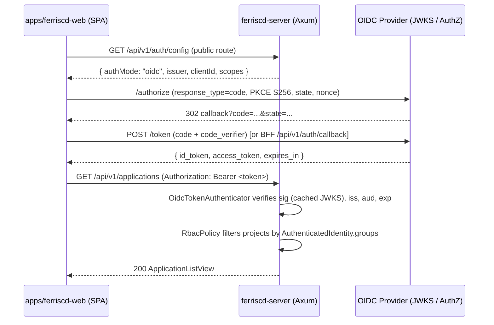

# FerrisCD — Post-`v1.0` Backlog & Extension Points (`v1.x`)

> **Status:** Post-`v1.0` Design Backlog (Explicitly Out of Scope for `v1.0`)  
> **Roadmap Task:** `T16.8` ([track-d-platform.md](../roadmap/track-d-platform.md))  
> **Audited Against:** `ferriscd-crd` (`ferriscd.io/v1alpha1`), `ferriscd-engine`, `ferriscd-controller`, `ferriscd-server`  
> **Related Docs:** [MASTER_PLAN.md](../MASTER_PLAN.md) (ADR-001–ADR-008), [REVIEW_LOG.md](../REVIEW_LOG.md) (Finding M5), [ADR-0003](../adr/0003-gknn-inventory-and-tracking-id.md)

---

## 1. Purpose & Scope Guard

FerrisCD `v1.0` intentionally ships a lean, production-hardened core:
- **Model 1 reconciliation (ADR-004):** on-demand scoped fetches (`desired ∪ prev_inventory`) triggered by periodic requeue, Git webhooks, or `Application` spec/control-annotation changes — with zero cluster-wide workload informers.
- **Git-only sources (`SourceSpec::git`):** HTTPS/SSH repositories via `gix` behind `GitClient`, feeding plain YAML, Kustomize v5, and Helm v4 renderers.
- **Kubernetes-native API AuthN/RBAC:** `AuthPolicy::TokenReview` + `ferriscd-rbac-cm` project-scoped authorization.
- **Two CRDs (`ferriscd.io/v1alpha1`):** `Application` and `AppProject`.

This document specifies **four high-value post-`v1.0` extensions** so that `v1.0` scope stays disciplined while proving that every future capability plugs cleanly into existing Rust traits and `v1alpha1` CRD schemas **without a breaking CRD migration or conversion webhook**:

1. [Opt-In Trigger-Only `PartialObjectMetadata` Label-Scoped `DriftWatcher`](#2-extension-1-opt-in-trigger-only-partialobjectmetadata-driftwatcher)
2. [OCI Artifact Source (`spec.source.oci`) for Helm Charts & Kustomize Bundles](#3-extension-2-oci-artifact-source-specsourceoci)
3. [OIDC / SSO Login for `ferriscd-server` & `apps/ferriscd-web`](#4-extension-3-oidc--sso-login-for-ferriscd-server--appsferriscd-web)
4. [ApplicationSet-Style Generators & Slack/Webhook Notifications](#5-extension-4-applicationset-style-generators--slackwebhook-notifications)

> **Scope Rule (Trap Guard):** None of the four extensions below may land before `v1.0` is tagged and verified. Each extension is strictly opt-in (`v1.x`) and must preserve every FerrisCD engineering invariant (no `unwrap`/`expect` in runtime code, blocking work inside `tokio::task::spawn_blocking`, version-agnostic GKNN inventory, SSA safety defaults, Secret redaction, and `k8s-openapi` version-feature hygiene).

---

## 2. Extension 1: Opt-In Trigger-Only `PartialObjectMetadata` `DriftWatcher`

### 2.1 Motivation & ADR-004 Boundary

Under Model 1 (`v1.0`), out-of-band cluster drift (e.g., an operator running `kubectl edit deployment` directly) is detected on the next periodic requeue (`spec.requeueAfterSeconds`, default `180s`) or manual refresh (`ferriscd.io/refresh`). Model 1 keeps controller memory bounded and respects least-privilege RBAC, because the controller never runs background full-object informers across arbitrary workload kinds.

Some production clusters require **sub-second drift wakeups** for `selfHeal: true` applications without paying the RAM cost of caching full `Pod`/`ConfigMap`/`Secret` bodies in controller memory. `DriftWatcher` bridges that gap as an **opt-in, trigger-only** acceleration layer that leaves Model 1 intact as the source of truth.

### 2.2 Labeling Contract & Finding M5 Resolution

Today, `ferriscd_engine::inventory::stamp_tracking_id` (`crates/ferriscd-engine/src/inventory/tracking.rs`) stamps the version-agnostic ownership annotation:

```text
metadata.annotations["ferriscd.io/tracking-id"] = "<app-ns>/<app-name>:<group>/<kind>:<res-ns>/<res-name>"
```

Kubernetes watch label selectors cannot filter on annotations. A naive `ferriscd.io/app=<name>` label fails **Finding M5** (`REVIEW_LOG.md`):
1. Kubernetes label values are capped at **63 characters** (whereas `Application` names may be up to 253 characters).
2. An unscoped `<name>` collides across namespaces when Apps-in-any-namespace (`--application-namespaces`, `T12.2` / ADR-007) is enabled.

When `DriftWatcher` is enabled (or unconditionally in `v1.x` as additive metadata alongside `tracking-id`), `stamp_tracking_id` also stamps **two labels** onto every non-hook managed resource (lifecycle hooks continue to be skipped):

| Label Key | Value Format | Purpose |
|---|---|---|
| `ferriscd.io/managed-by` | `ferriscd` | Server-side watch label selector (`ferriscd.io/managed-by=ferriscd`) so unmanaged cluster objects never cross the wire. |
| `ferriscd.io/app-hash` | `<16-hex-sha256>` | First 16 lowercase hex chars (64 bits) of `SHA-256("<app-ns>/<app-name>")`, computed via `ferriscd_engine::diff::sha256::digest`. |

**Why `<16-hex-sha256>` is safe:**
- Always exactly **16 lowercase `[0-9a-f]` characters** — guaranteed valid under Kubernetes's 63-char DNS/label-value rule regardless of `Application` name or namespace length.
- Uniquely binds both `app_namespace` and `app_name` (separated by `/`, which cannot appear in either DNS label), eliminating cross-namespace collisions.
- Even in the astronomical event of a 64-bit hash collision between two `Application`s, `DriftWatcher` is **trigger-only**: the resulting reconcile pass still verifies exact `ferriscd.io/tracking-id` ownership and runs the full SSA dry-run diff. A collision causes at most one harmless no-op reconcile.
- **Immutability guard:** Never stamp `ferriscd.io/managed-by` or `ferriscd.io/app-hash` into immutable pod-template selectors (`spec.selector.matchLabels`) — only onto the top-level `metadata.labels` of each managed resource.

### 2.3 Trigger-Only `PartialObjectMetadata` Watch Architecture

```mermaid
flowchart LR
    K8s["Target Cluster API Server\n(PartialObjectMetadata + labelSelector)"]
    DW["DriftWatcher\n(per cluster × active GVK)"]
    Echo["SelfEchoCache\n(cluster, GKNN, resourceVersion)"]
    Deb["Per-App Trailing Debouncer\n(2s window + shard filter)"]
    Ctrl["NamespacedController\nController::for_stream(...).reconcile_on(rx)"]
    Pipe["Existing Model 1 SyncPipeline\n(live GET + SSA dryRun=All)"]

    K8s -- "metadata-only WatchEvents" --> DW
    DW -- "drop self-applied RV / status-only" --> Echo
    Echo -- "lookup app-hash -> ObjectRef<Application>" --> Deb
    Deb -- "coalesced ObjectRef<Application>" --> Ctrl
    Ctrl --> Pipe
    Pipe -- "record applied resourceVersion" --> Echo
```



Key architectural rules:
1. **Metadata-only watches:** Watch each active `(cluster, GVK)` using `kube::runtime::watcher::metadata_watcher` over `Api::<PartialObjectMetadata<DynamicObject>>::all_with(client, &api_resource)` with `watcher::Config::default().labels("ferriscd.io/managed-by=ferriscd")`. Because the Kubernetes API server returns `meta.k8s.io/v1 PartialObjectMetadata` tables, **zero `.spec`, `.status`, or `Secret.data` bytes ever leave the API server or occupy controller RAM**.
2. **Dynamic GVK set:** Watch only the GVKs currently present in at least one watched `Application`'s `status.inventory` (resolved through `DiscoveryCache`), optionally restricted by an operator `--drift-watcher-kinds` allowlist and hard watch-count cap (e.g., `MAX_DRIFT_WATCHES = 64` per cluster). Never open watches for every GVK in `Discovery`.
3. **Reverse index (`app-hash -> ObjectRef<Application>`):** Maintained from each `NamespacedController::store()` (`Store<Application>` in `crates/ferriscd-controller/src/controller.rs`). Because `Application`s are already reflected per watched namespace, resolving `ferriscd.io/app-hash` to one or more `reflector::ObjectRef<Application>` values is an `O(1)` in-memory lookup.
4. **Shard and cluster isolation:**
   - Before enqueueing, filter each resolved `ObjectRef<Application>` through `ControllerConfig::shard` (`Sharding::owns(namespace, name)` from `crates/ferriscd-controller/src/sharding.rs`) so sharded replicas never wake up for another shard's applications.
   - Extend `ClusterManager` (`crates/ferriscd-controller/src/cluster_manager.rs`, where `ClusterChange` currently returns `{ Added, Rebuilt, Unchanged }` from `seed()`) with a lifecycle broadcast channel (`tokio::sync::broadcast` emitting `Added` / `Rebuilt` / `Removed`) so remote-cluster `DriftWatcher` tasks start on cluster registration and are cancelled cleanly when a `ferriscd.io/secret-type=cluster` `Secret` is deleted.

### 2.4 Wiring Into `Controller::reconcile_on`

In `crates/ferriscd-controller/src/controller.rs`, `build_controllers` currently constructs one `NamespacedController` per watched scope:

```rust
// Existing v1.0 construction in crates/ferriscd-controller/src/controller.rs
let controller = Controller::for_stream(stream, store).with_config(
    kube::runtime::controller::Config::default().concurrency(config.concurrency),
);
```

To wire `DriftWatcher` without altering `scoped_store`, `ApplicationPredicate`, or `ReconcileContext`:
- Create one bounded `tokio::sync::mpsc::channel::<reflector::ObjectRef<Application>>(256)` per `NamespacedController` scope.
- Chain `.reconcile_on(ReceiverStream::new(drift_rx))` directly onto `Controller::for_stream(stream, store)`.
- `DriftWatcher` sends coalesced `ObjectRef<Application>` triggers into the matching scope's sender using `try_send` (if the bounded channel is full, a reconcile is already queued or periodic requeue will cover it — `DriftWatcher` must **never** backpressure or block the watch loop).
- Because `Controller::reconcile_on` feeds straight into `kube-rs`'s built-in work-queue deduplicator, duplicate triggers for an in-flight `Application` are automatically collapsed and scheduled safely within `config.concurrency`.

### 2.5 Debouncing & `resourceVersion` Self-Echo Suppression

Two production feedback loops must be prevented by construction:

1. **Multi-resource burst debouncing:**
   - A rollout or operator batch edit can emit dozens of `WatchEvent`s in milliseconds.
   - `DriftWatcher` applies a per-`Application` trailing-edge debounce window (default `2s`, matching `WebhookConfig::debounce` in `crates/ferriscd-server/src/webhooks.rs`) with a bounded max-wait ceiling (e.g., `5s`) so continuous churn still triggers timely reconciliation without starving the work queue.

2. **`resourceVersion` self-echo suppression (critical for `ConfigMap` & `Secret`):**
   - Workload controllers (`Deployment`, `StatefulSet`, `DaemonSet`, `Ingress`, CRDs) bump `metadata.generation` on `.spec` mutations and leave it unchanged on `/status` updates. For generation-bearing kinds (`metadata.generation.is_some()`), `DriftWatcher` suppresses events where `(uid, generation)` did not change (filtering out pod-readiness/status chatter).
   - **Trap:** Core `ConfigMap` and `Secret` objects **do not have a `metadata.generation` field** (`generation` is always `None` even when `.data` changes). Relying on `generation` would either miss all `ConfigMap`/`Secret` drift or trigger an infinite loop every time FerrisCD's own SSA apply updates a `ConfigMap`/`Secret`!
   - **Solution:** `Applier::apply` (`crates/ferriscd-controller/src/sync.rs`) already returns `Result<DynamicObject, ReconcileError>` carrying the API server's post-apply `metadata.resource_version`. Immediately after each confirmed SSA apply (and confirmed prune), `SyncExecutor` records `(cluster, ResourceKey, applied_resource_version)` in a bounded, TTL-expiring `SelfEchoCache` (e.g., `60s` TTL, `10_000` cap) shared with `DriftWatcher`.
   - When `DriftWatcher` observes an event for `(cluster, key)` whose `metadata.resource_version` matches the cached self-applied `resourceVersion`, it drops the event as a self-echo. Any external edit produces a newer `resourceVersion` and triggers immediately.
   - On `WatchEvent::Deleted` (an out-of-band `kubectl delete` of a managed resource), `DriftWatcher` checks whether that `(cluster, key)` is in the recent self-pruned set; if not, it immediately triggers a reconcile so `selfHeal: true` recreates it.

### 2.6 Graceful `403 Forbidden` Fallback to Model 1 Polling

`DriftWatcher` requires `list` + `watch` on the watched resource kinds (filtered by `ferriscd.io/managed-by=ferriscd`). In hardened or multi-tenant clusters where the controller's RBAC intentionally omits `list`/`watch` on certain kinds (for example, `Secret`s or cluster-scoped RBAC objects):

- If a `metadata_watcher` stream fails with a `watcher::Error` wrapping `kube::core::Status { code: 403, .. }` / `kube::Error::Api(status)` (`status.code == 403`) (or `404` / `405` when a CRD is removed or does not support watch):
  1. Log a single structured `tracing::warn!` naming `(cluster, gvk)` and noting fallback to periodic polling.
  2. Increment `ferriscd_drift_watcher_fallback_total{reason="forbidden"}` (keeping labels strictly low-cardinality in `crates/ferriscd-controller/src/metrics.rs` per `T15.1`, or bounding any `gvk` label by `MAX_DRIFT_WATCHES`).
  3. Stop retrying that `(cluster, gvk)` watcher (or back off on a long cooldown such as `15m` to detect later RBAC grants without spamming API server audit logs).
  4. **Never** mark `Application` `Ready=False` and **never** crash the controller — Model 1 periodic polling (`spec.requeueAfterSeconds`) continues reconciling those resources identically to `v1.0`.
- **Feature gate:** Disabled by default (`--enable-drift-watcher=false` / `FERRISCD_ENABLE_DRIFT_WATCHER=false`).

---

## 3. Extension 2: OCI Artifact Source (`spec.source.oci`)

### 3.1 Motivation

Modern GitOps pipelines increasingly publish signed, immutable Helm charts (OCI-native in Helm v4) and Kustomize/YAML manifest bundles directly to OCI container registries (`ghcr.io`, ECR, GAR, Harbor) using ORAS / Flux-compatible media types. Supporting `spec.source.oci` eliminates redundant Git mirror repos for release artifacts while reusing FerrisCD's entire rendering, normalization, diff, sync, and policy pipeline.

### 3.2 Additive CRD Schema (`SourceSpec` in `crates/ferriscd-crd/src/application.rs`)

Today (`v1.0`), `ApplicationSpec::source` is typed as `SourceSpec`:

```rust
// Current v1.0 definition (crates/ferriscd-crd/src/application.rs)
pub struct SourceSpec {
    pub git: GitSourceSpec,
    #[serde(default)]
    pub renderer: RendererSpec,
}
```

In `v1.x`, `SourceSpec` evolves **additively** to support either `git` or `oci` (mutually exclusive):

```rust
// Proposed v1.x evolution (wire-compatible with all v1alpha1 Application CRs)
#[derive(Serialize, Deserialize, Debug, Clone, PartialEq, Eq, JsonSchema)]
#[serde(rename_all = "camelCase")]
pub struct SourceSpec {
    /// Git repository source. Mutually exclusive with `oci`.
    #[serde(default, skip_serializing_if = "Option::is_none")]
    pub git: Option<GitSourceSpec>,

    /// OCI artifact source (Helm chart or Kustomize/YAML bundle). Mutually exclusive with `git`.
    #[serde(default, skip_serializing_if = "Option::is_none")]
    pub oci: Option<OciSourceSpec>,

    /// Renderer used to turn the fetched path into Kubernetes manifests.
    #[serde(default)]
    pub renderer: RendererSpec,
}

#[derive(Serialize, Deserialize, Debug, Clone, PartialEq, Eq, JsonSchema)]
#[serde(rename_all = "camelCase")]
pub struct OciSourceSpec {
    /// OCI artifact reference (`oci://<registry>/<repository>`, HTTPS-only by default).
    pub url: String,

    /// Tag or SemVer range (e.g., `"1.4.2"` or `"^1.4.0"`). Optional when `digest` is pinned.
    #[serde(default, skip_serializing_if = "Option::is_none")]
    pub tag: Option<String>,

    /// Immutable manifest digest (`sha256:<64-hex>`). Recommended for production pinning.
    /// When both `tag` and `digest` are set, the fetched manifest digest must equal `digest`.
    #[serde(default, skip_serializing_if = "Option::is_none")]
    pub digest: Option<String>,

    /// Optional sub-directory inside the extracted artifact archive (`""` means archive root).
    #[serde(default)]
    pub path: String,
}
```

**Mutual-Exclusion Validation (Online + Offline Parity):**
- **CRD OpenAPI v3 CEL rule (`x-kubernetes-validations`, GA in Kubernetes 1.29+ / v1.35):**
  ```yaml
  x-kubernetes-validations:
    - rule: "(has(self.git) && !has(self.oci)) || (!has(self.git) && has(self.oci))"
      message: "exactly one of spec.source.git or spec.source.oci must be specified"
  ```
  And on `OciSourceSpec`:
  ```yaml
  x-kubernetes-validations:
    - rule: "has(self.tag) || has(self.digest)"
      message: "at least one of spec.source.oci.tag or spec.source.oci.digest must be specified"
  ```
- **Offline parity:** Extend `ApplicationSpec::validate(&self)` (`crates/ferriscd-crd/src/application.rs`) with `SpecValidationError::MissingSource`, `SpecValidationError::AmbiguousSource`, `SpecValidationError::InvalidOciUrl`, and `SpecValidationError::InvalidOciDigest` so CLI and unit tests reject invalid specs identically to the API server (`422`).
- **Why this is non-breaking for `v1alpha1` CRs:** Relaxing `source.required: [git]` in the CRD OpenAPI schema and adding optional `source.properties.oci` accepts **100% of existing `v1alpha1` `Application` objects in `etcd` unchanged**, preserves byte-identical YAML/JSON round-trips for existing Git applications (`skip_serializing_if = "Option::is_none"`), and requires **no** conversion webhook or storage version bump. (See [Section 6](#6-crd-non-breaking-compatibility-matrix) for the full audit.)

### 3.3 Engine Pipeline, Caching & Security Invariants

1. **Encapsulated `OciClient` trait (`crates/ferriscd-engine/src/repo/`):**
   - Mirror `GitClient` (`resolve_revision` + `checkout`) with an object-safe `OciClient` trait (`resolve_digest` -> immutable `sha256:<64-hex>`, `fetch_artifact` -> read-only `RepoCheckout` handle keyed by digest) so third-party OCI registry client crates stay strictly behind `repo/` just like `gix`.
   - Supported artifact media types:
     - Helm chart OCI artifacts (`application/vnd.cncf.helm.chart.content.v1.tar+gzip`)
     - Generic/Kustomize OCI bundles (`application/vnd.oci.image.layer.v1.tar+gzip`, Flux `application/vnd.cncf.flux.content.v1.tar+gzip`)
   - **Async hygiene:** Archive decompression, SHA-256 verification, and extraction to `/tmp` run strictly inside `tokio::task::spawn_blocking`.
2. **Untrusted Artifact Defense (Tar-Slip & Bomb Parity):**
   - Verify manifest and layer SHA-256 digests before extracting.
   - Enforce `WorktreeLimits` (`crates/ferriscd-engine/src/repo/sanitize.rs`) during streaming tar extraction (max file count, max total uncompressed bytes to stop tar bombs, reject absolute paths, `..` path traversal, FIFOs/device nodes, and hardlinks escaping root).
   - Run the existing `sanitize_worktree` pass over the extracted directory before handing the path to `RenderPipeline`.
3. **Zero Changes to Rendering, Diffing, or Policy Semantics:**
   - **Renderers (`crates/ferriscd-engine/src/manifest/renderer.rs`):** Once extracted to a read-only local directory, `PlainYamlRenderer`, `KustomizeRenderer` (remote bases still blocked), and `HelmRenderer` (`helm template` in strict offline mode) operate verbatim with zero renderer-specific OCI network access.
   - **Render Cache (`RenderCacheKey` in `crates/ferriscd-engine/src/manifest/cache.rs`):** Populate `repo_url = oci.url`, `commit_sha = resolved_digest`, `source_path = oci.path`, preserving Finding M1's collision-free 8-tuple key.
   - **Spec Hash (`source_spec_hash` in `crates/ferriscd-engine/src/diff/decision.rs`):** Already hashes canonical JSON of `(spec.source, spec.destination)`, so editing `spec.source.oci.tag` or `digest` automatically updates `status.sync.lastSyncedSpecHash` (Finding H7).
   - **Status & History (`crates/ferriscd-crd/src/status.rs`):** `SyncState.revision` / `lastSyncedRevision` stores the immutable `sha256:<64-hex>` digest. `SourceSummary` stores the redacted `oci://...` URL in `repoURL` (or an additive `ociUrl: Option<String>`), plus `targetRevision` = tag/digest, keeping `status.history` metadata-only and hard-capped at `MAX_HISTORY_ENTRIES = 20`.
   - **Tenancy Policy (`AppProjectPolicy` in `crates/ferriscd-engine/src/policy/app_project.rs`):** `check_application` evaluates `spec.source.oci.url` against `AppProjectSpec::source_repos` using the existing `wildcard_matches` matcher (e.g., `oci://ghcr.io/payments/*`) — **zero changes to `AppProjectSpec`**.

### 3.4 Registry Authentication (Reusing `ferriscd.io/secret-type=repository`)

Reuse `crates/ferriscd-controller/src/credentials.rs` verbatim:
- Operators create a `Secret` in `ferriscd-system` (control-plane namespace only — never cluster-wide) labeled `ferriscd.io/secret-type: repository`:
  ```yaml
  apiVersion: v1
  kind: Secret
  metadata:
    name: oci-ghcr-payments
    namespace: ferriscd-system
    labels:
      ferriscd.io/secret-type: repository
  stringData:
    url: oci://ghcr.io/payments
    username: ferriscd-puller
    password: <registry-token> # or `token:` / optional `.dockerconfigjson`
  ```
- Extend `CredentialTemplate::from_secret` (`crates/ferriscd-controller/src/credentials.rs`) to accept `SCHEME_OCI = "oci"` alongside `SCHEME_HTTPS` and `SCHEME_SSH`, rejecting `sshPrivateKey`/`knownHosts` on `oci://` templates and enforcing the exact same longest-prefix path-boundary matching, `redact_repo_url` logging discipline, and terminal `CredentialError` semantics.
- Optional future extension: workload identity / cloud registry token exchange (IRSA, Workload Identity Federation) plugged into `CredentialSource` without changing `ApplicationSpec`.

---

## 4. Extension 3: OIDC / SSO Login for `ferriscd-server` & `apps/ferriscd-web`

### 4.1 Motivation

In `v1.0`, `ferriscd-server` validates `Authorization: Bearer <token>` via Kubernetes `TokenReview` (`AuthPolicy::TokenReview`), which is ideal for CI/CD `ServiceAccount` tokens and `ferriscd login`. Human operators using `apps/ferriscd-web` in enterprise environments prefer SSO against an existing OIDC Identity Provider (Okta, Keycloak, Dex, Entra ID, Google) with automatic group-based RBAC.

### 4.2 Plugging Into Existing `ferriscd-server` Seams

`crates/ferriscd-server/` was designed with clean auth/RBAC seams that require **zero changes to handlers or `RbacPolicy`**:

| Existing Seam | Location | `v1.x` OIDC Extension |
|---|---|---|
| `AuthPolicy` | `crates/ferriscd-server/src/auth.rs` | Add `AuthPolicy::Oidc` and `AuthPolicy::TokenReviewOrOidc` (`--auth-policy oidc` / `token-review-or-oidc`) so human OIDC JWTs and CI `ServiceAccount` tokens can coexist cleanly. Keep `AuthPolicy::TokenReview` as the default. |
| `TokenAuthenticator` trait | `crates/ferriscd-server/src/auth.rs` | Implement `OidcTokenAuthenticator` (local JWKS signature + claim validation) and `CompositeTokenAuthenticator` behind the exact existing signature `authenticate(&self, token: &str) -> SeamFuture<'_, Option<AuthenticatedIdentity>>`, injected via `AppState::with_token_authenticator`. |
| `AuthenticatedIdentity` | `crates/ferriscd-server/src/auth.rs` | Map configured OIDC username claim (e.g., `email` or `sub`) -> `username` (with mandatory prefix such as `oidc:` to prevent colliding with `system:serviceaccount:*`), and OIDC `groups` claim -> `groups`. |
| `IdentityCache` | `crates/ferriscd-server/src/auth.rs` | Reuse SHA-256 `token_fingerprint`-keyed positive-only cache; clamp per-entry TTL to `min(DEFAULT_IDENTITY_CACHE_TTL, jwt_exp - now)` so expired tokens never outlive their `exp` claim. |
| `RbacPolicy` | `crates/ferriscd-server/src/rbac.rs` | **Unchanged.** Existing `ferriscd-rbac-cm` `policy.yaml` rules (`subject: { kind: group, name: "oidc:payments-team" }`, `project: payments`, `actions: [get, diff, sync]`) authorize OIDC users immediately, preserving default-deny and `404`-if-unseen / `403`-if-visible semantics. |

### 4.3 Authentication Flow (PKCE for SPA + CLI Compatibility)



**Public Discovery Endpoints (`crates/ferriscd-server/src/api.rs`):**
- Add `GET /api/v1/auth/config` to the `public` router group (alongside `/healthz` and `/readyz`), never modifying the `protected` group's `route_layer(middleware::from_fn_with_state(state.clone(), auth::authenticate))`.
- The SPA (`apps/ferriscd-web`) calls `/api/v1/auth/config` at boot:
  - When `authMode == "token-review"`, render the `v1.0` bearer-token sign-in modal.
  - When `authMode` includes OIDC, render the "Sign in with SSO" button initiating **Authorization Code Flow with PKCE (`S256`)** (and optional token paste fallback when `token-review-or-oidc` is active).
- **Browser token storage security:** Store the OIDC token **in memory only** (React state/context — never `localStorage` or `sessionStorage`) to limit XSS persistence, OR enable optional BFF mode (`GET /api/v1/auth/login`, `GET /api/v1/auth/callback`, `POST /api/v1/auth/logout`) setting an `HttpOnly; Secure; SameSite=Lax` encrypted session cookie plus a CSRF double-submit header on mutating `POST` routes (`/sync`, `/rollback`).
- **CLI compatibility (`ferriscd login --oidc`):** Reuse the exact same PKCE flow with an ephemeral `127.0.0.1:<random-port>` loopback redirect listener and persist the resulting short-lived token into `~/.config/ferriscd/config.json` (`0600` permissions, matching `T14.5`).

### 4.4 JWKS Verification & Security Guardrails

1. **HTTPS-only discovery & JWKS refresh:** Fetch `<issuer>/.well-known/openid-configuration` and `jwks_uri` over HTTPS with system/configured CA trust (`rustls`). Never allow `http://` issuers in production.
2. **Algorithm & claim pinning:**
   - Explicitly allow only asymmetric signature algorithms (`RS256`, `ES256`, `ES384`, `EdDSA`). **Reject `alg: none` and `HS*` symmetric algorithms** to defeat key-confusion attacks.
   - Strictly validate `iss` (exact match), `aud` (must contain configured `clientId`), `exp`, `nbf` (bounded clock skew `<= 30s`), and non-empty `sub`.
3. **DoS protection on unknown `kid`:** Rate-limit on-demand JWKS refetches (e.g., at most once per `60s` per server instance) so an attacker sending JWTs with random `kid` headers cannot trigger outbound request storms to the IdP.
4. **Identity namespace isolation:** Require non-empty `--oidc-username-prefix` (default `oidc:`) and `--oidc-groups-prefix` (default `oidc:`) so an external IdP claim can never spoof Kubernetes `system:masters`, `system:serviceaccount:*`, or cluster-local groups.
5. **Secret hygiene:** Any OIDC client secret or BFF cookie encryption key is loaded from a `ferriscd-system` `Secret` (`ferriscd.io/secret-type: oidc`), redacted in `Debug`/`Display`/errors; raw JWTs remain inside `BearerToken` and appear in logs only via 12-hex `fingerprint_label`.

---

## 5. Extension 4: ApplicationSet-Style Generators & Slack/Webhook Notifications

### 5.1 ApplicationSet-Style Matrix & Git-Directory Generators

#### Architectural Isolation
Ship as an **additive CRD (`ApplicationSet`, `ferriscd.io/v1alpha1`)** managed by an independent opt-in controller loop (`--enable-applicationsets=false` by default), rather than overloading `ApplicationSpec`. `Application` remains a single-source, single-destination primitive.

#### Core Generators
| Generator | Input | Reused FerrisCD Seam |
|---|---|---|
| `list` | Static array of key/value maps in `ApplicationSet.spec.generators[].list` | None (pure in-memory) |
| `clusters` | Label selector over registered cluster `Secret`s (`ferriscd.io/secret-type=cluster`) | `ClusterManager` (`crates/ferriscd-controller/src/cluster_manager.rs`) |
| `git` | Directory glob (`directories: [{ path: "apps/*" }]`) or JSON/YAML parameter files (`files: [{ path: "envs/*/config.yaml" }]`) | `GitClient`, `RepoCache`, `sanitize_worktree`, `CredentialSource`, guarded `serde-saphyr` parser (`parse_document`) |
| `matrix` | Cartesian product of exactly two child generators (e.g., `clusters` × `git.directories`) | Composes the above with a hard output cap (`MAX_GENERATED_APPS`, default `200`) to prevent accidental fan-out bombs |

#### Safety & Multi-Tenancy Guardrails
1. **Strict non-Turing-complete templating:** Substitute only flat `{{key}}` placeholders (`{{cluster.name}}`, `{{path.basename}}`, `{{path[1]}}`) with DNS-1123 sanitization — no Go `text/template` loops/functions or arbitrary script execution.
2. **Non-destructive deletion default:** Mirror `Application`'s non-cascading deletion safety (Finding C5): `spec.syncPolicy.preserveResourcesOnDeletion` defaults to `true`, so deleting an `ApplicationSet` (or a transient Git directory listing error) never mass-deletes generated `Application`s unless explicitly opted in.
3. **Zero tenancy bypass:** Generated `Application` objects live in the same namespace as their owning `ApplicationSet` (using same-namespace `metadata.ownerReferences` + label `ferriscd.io/applicationset=<name>`). Every generated `Application` passes through the exact same `ApplicationScope`, `AppProjectPolicy`, and `ImpersonationPool` checks as a hand-authored `Application`.
4. **Conflict protection:** Refuse to overwrite an existing `Application` whose `ownerReferences` belong to a different `ApplicationSet` or to an operator (unmanaged), surfacing a `Ready=False` condition on `ApplicationSet.status`.

### 5.2 Slack & Generic Webhook Notifications

#### Annotation-Driven Opt-In (Zero `ApplicationSpec` Changes)
Applications opt into notifications exclusively through **annotations**, following Kubernetes/Argo conventions:

```yaml
apiVersion: ferriscd.io/v1alpha1
kind: Application
metadata:
  name: payment-service
  namespace: ferriscd-system
  annotations:
    notifications.ferriscd.io/subscribe.on-sync-failed.slack: "payments-alerts"
    notifications.ferriscd.io/subscribe.on-health-degraded.slack: "payments-alerts"
    notifications.ferriscd.io/subscribe.on-sync-succeeded.ops-webhook: "deployments"
```

**Why this has zero impact on the core reconciler:**
`crates/ferriscd-controller/src/predicate.rs` hashes only `TRACKED_ANNOTATIONS` (`ferriscd.io/refresh`, `ferriscd.io/operation`, `ferriscd.io/cascade-delete`, `ferriscd.io/force-delete`). Adding or editing `notifications.ferriscd.io/*` annotations produces an identical `composite_hash` and triggers **zero** core reconciles.

#### Observer Architecture & Triggers
A lightweight, opt-in `NotificationObserver` watches `Application` status transitions (sharing the existing `ApplicationControllers` store or observing `/status` commits via a `StatusWriter` decorator hook — zero extra API server reads when wired around `ApiStatusWriter`):

| Trigger Name | Firing Condition (Edge-Triggered) |
|---|---|
| `on-sync-succeeded` | `status.sync.lastSyncedRevision` advances and `status.operationState.phase == Succeeded` (or `Ready=True, reason=SyncSucceeded`) |
| `on-sync-failed` | `status.operationState.phase` transitions into `Failed`/`Error`, or `Ready` transitions to `False` |
| `on-health-degraded` | `status.health.status` transitions from non-`Degraded` into `Degraded` |
| `on-out-of-sync` | `status.sync.status` transitions `Synced -> OutOfSync` and remains `OutOfSync` past a configurable debounce window |

#### Configuration, Reliability & Security Guardrails
- **Control-plane-only config & secrets:**
  - Notification templates and trigger definitions live in `ConfigMap/ferriscd-notifications-cm` in `ferriscd-system` (parsed with `ferriscd_engine::manifest::parse_document` under YAML budgets).
  - Slack bot tokens / incoming webhook URLs / generic webhook HMAC signing secrets live in `Secret`s labeled `ferriscd.io/secret-type: notifications` in `ferriscd-system` — **never** in `Application` annotations or `ConfigMap`s.
- **Deduplication:** Deduplicate deliveries on `(app_ns, app_name, trigger, observed_generation, revision, health_status)` inside a bounded in-memory LRU (or optional status annotation only if cross-restart dedupe is explicitly enabled) so periodic 180s requeues never re-page Slack for an unchanged failure.
- **Non-blocking delivery:** Enqueue notification jobs onto a bounded async worker channel (`try_send`, dropping with a warning + metric if saturated) with strict `5s` HTTP timeouts and capped retries (`3` attempts), ensuring a slow Slack API can **never** delay a Kubernetes reconcile.
- **SSRF & Secret Redaction:**
  - Outbound webhook URLs must use `https://` and reject link-local/cloud-metadata IP ranges (`169.254.169.254`, `fe80::/10`, loopback) after DNS resolution unless explicitly allowlisted.
  - Notification payloads draw exclusively from redacted `ApplicationStatus` fields (`sync`, `health`, `conditions`, `history`) and `redact_repo_url` — never raw `Secret` data or unredacted diffs.

---

## 6. CRD Non-Breaking Compatibility Matrix

Audited directly against the live `v1.0` structs and committed CRD manifests:
- `crates/ferriscd-crd/src/application.rs` (`ApplicationSpec`, `SourceSpec`, `GitSourceSpec`, `RendererSpec`, `DestinationSpec`, `SyncPolicy`, `SyncOptions`, `IgnoreDifference`, `RetryPolicy`)
- `crates/ferriscd-crd/src/status.rs` (`ApplicationStatus`, `SyncState`, `HealthState`, `InventoryEntry`, `ResourceStatus`, `ActiveHook`, `OperationState`, `RevisionHistoryEntry`, `SourceSummary`)
- `crates/ferriscd-crd/src/project.rs` (`AppProjectSpec`, `ProjectDestination`, `GroupKind`, `AppProjectStatus`)
- `crates/ferriscd-crd/src/annotations.rs` (`CONTROL_ANNOTATIONS`) & `crates/ferriscd-controller/src/predicate.rs` (`TRACKED_ANNOTATIONS`)
- `deploy/crds/applications.ferriscd.io.yaml` & `deploy/crds/appprojects.ferriscd.io.yaml`

| Extension | Target CRD / Rust Struct | Exact Schema / Contract Delta | Existing `v1alpha1` CRs in `etcd` | Conversion Webhook Needed? | Watch Predicate & `etcd` Status Impact |
|---|---|---|---|---|---|
| **1. Opt-in `DriftWatcher`** | **None** on `Application` or `AppProject` (`ferriscd-crd` unchanged) | Stamps two additive labels (`ferriscd.io/managed-by=ferriscd`, `ferriscd.io/app-hash=<16-hex-sha256>`) onto managed cluster resources alongside existing `ferriscd.io/tracking-id` annotation. Controller flag `--enable-drift-watcher` (default `false`). | **100% unchanged** — zero CRD edit. | **No** | Zero `Application.status` growth; zero change to `ApplicationPredicate` / `TRACKED_ANNOTATIONS`. |
| **2. OCI Artifact Source (`spec.source.oci`)** | `ApplicationSpec.source` (`SourceSpec` in `crates/ferriscd-crd/src/application.rs`); optional `SourceSummary` fields in `status.rs` | Relax `spec.source.required: [git]` to `[]`; add optional `spec.source.oci` (`OciSourceSpec`, `skip_serializing_if = "Option::is_none"`); add CEL `x-kubernetes-validations` mutual-exclusion rule `has(self.git) != has(self.oci)`. Optionally add `ociUrl`/`digest` (`Option<String>`) to `SourceSummary`. `AppProjectSpec::sourceRepos` reused as-is (`oci://...` globs). | **100% wire-compatible** — every stored `v1alpha1` `Application` already has `spec.source.git` set and `oci` absent, passes the relaxed schema + CEL rule, and round-trips byte-identically. | **No** | `source_spec_hash` automatically covers `spec.source.oci`; `status.history` stays metadata-only (`<= 20` entries). *(Note below on Rust struct field type.)* |
| **3. OIDC / SSO Login** | **None** on `Application` or `AppProject` (`ferriscd-crd` unchanged) | Control-plane-only config: new `AuthPolicy` variants + `OidcTokenAuthenticator` implementing existing `TokenAuthenticator` trait; OIDC secret (`ferriscd.io/secret-type: oidc`); public `GET /api/v1/auth/config` route. `ferriscd-rbac-cm` (`RbacPolicy`) unchanged. | **100% unchanged** — zero CRD edit. | **No** | Zero controller, predicate, or `etcd` impact. |
| **4a. `ApplicationSet` Generators** | **New additive CRD** `ApplicationSet` (`ferriscd.io/v1alpha1`); `Application` & `AppProject` unchanged | New CRD + opt-in controller loop generating standard `Application` CRs with same-namespace `ownerReferences` and `ferriscd.io/applicationset` label. | **100% unchanged** — existing `Application`/`AppProject` schemas untouched. | **No** | Generated `Application`s obey identical `ApplicationPredicate` and bounded status caps. |
| **4b. Slack / Webhook Notifications** | **None** on `ApplicationSpec` or `AppProjectSpec` | Additive `notifications.ferriscd.io/subscribe.<trigger>.<service>` annotations on `Application.metadata.annotations`, plus `ferriscd-notifications-cm` `ConfigMap` & `ferriscd.io/secret-type: notifications` `Secret` in `ferriscd-system`. | **100% unchanged** — annotations are native Kubernetes metadata. | **No** | Zero spurious reconciles: `predicate::TRACKED_ANNOTATIONS` ignores `notifications.ferriscd.io/*`. Zero `Application.status` bloat. |

### Compatibility Audit Notes

1. **Kubernetes CRD Wire Schema vs. Internal Rust Struct (`SourceSpec.git`):**
   - On the **Kubernetes API / YAML / JSON wire** (`deploy/crds/applications.ferriscd.io.yaml`), changing `source.required` from `["git"]` to optional `git` + optional `oci` with a CEL mutual-exclusion rule is strictly backwards-compatible under Kubernetes API conventions: every existing `Application` remains valid without modification, no conversion webhook is needed, and upgrading the CRD in-place via `kubectl apply` or `helm upgrade` is lossless.
   - Inside the Rust workspace monolith (`crates/ferriscd-crd/src/application.rs`), changing `pub git: GitSourceSpec` to `pub git: Option<GitSourceSpec>` updates internal call sites at compile time (all within the same workspace). `ferriscd-crd` is an internal workspace crate, not a separately versioned public SDK, so this incurs zero user-facing migration cost.
2. **Existing `AppProjectSpec` Readiness:**
   - `AppProjectSpec` (`crates/ferriscd-crd/src/project.rs`) already exposes `source_repos`, `source_namespaces`, `destinations`, `cluster_resource_whitelist`, `namespace_resource_whitelist`, `namespace_resource_blacklist`, and `allowed_service_accounts`. All four post-`v1.0` extensions inherit multi-tenancy enforcement from these exact fields with **zero `AppProject` schema changes**.
3. **Existing `ApplicationSpec` Readiness:**
   - `ApplicationSpec` (`crates/ferriscd-crd/src/application.rs`) already reserves `project`, `service_account_name`, `sync_policy` (with `Option<AutomatedSyncPolicy>`), `ignore_differences`, `requeue_after_seconds` (`1..=86_400`), and `revision_history_limit` (`1..=20`). None of these fields need renames, type changes, or behavioral breaks for any `v1.x` extension.

---

## 7. Recommended `v1.x` Rollout Order & Non-Regression Checklist

| Release | Extensions | Rationale |
|---|---|---|
| **`v1.1`** | OIDC / SSO Login + Slack/Webhook Notifications | Zero CRD changes; highest immediate day-2 operator value for teams running the `v1.0` Web UI and production clusters. |
| **`v1.2`** | OCI Artifact Source (`spec.source.oci`) | Additive `SourceSpec` schema evolution + CEL rule; unlocks OCI-native Helm v4 and Kustomize distribution without Git mirror repos. |
| **`v1.3`** | Opt-in `DriftWatcher` + `ApplicationSet` Generators | Sub-second drift detection for latency-sensitive fleets and multi-cluster fleet generation, built atop the battle-tested `v1.0`–`v1.2` engine. |

Every `v1.x` PR implementing an item from this backlog must pass:
- `make gate` (`cargo fmt --check`, `cargo clippy --all-targets -- -D warnings`, `cargo test --workspace`) + `npm run typecheck && npm run test && npm run build` for Web UI changes.
- Determinism check on `deploy/crds/` (`ferriscd crd generate --check` / `crates/ferriscd-crd/src/generate.rs`) plus round-trip regression tests proving `v1.0` `Application` and `AppProject` fixtures deserialize and validate unchanged.
- Dedicated live `kind` (Kubernetes v1.35) integration tests guarded by the `kind-` context check (`AGENTS.md`).
- Security & secret-hygiene tests verifying zero credential leakage in `Debug`, `Display`, error messages, logs, diffs, and notifications.
